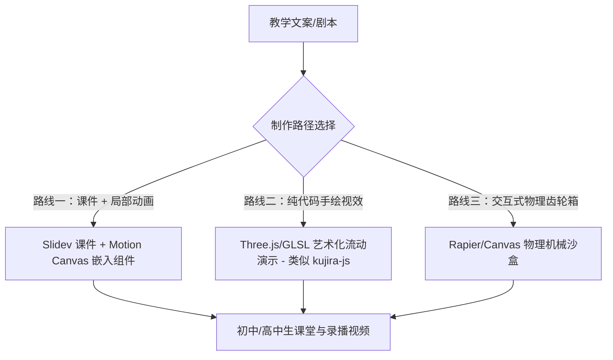

# 面向初高中生 AI 科普的动画技术栈与教学方案调研报告

## 1. 调研背景与目标
- **目标受众**：初中生、高中生。
- **教学痛点**：纯代码（Coding）过于抽象枯燥；学生需要生动、具象的视觉与机械比喻，理解 AI 的输入输出流程与核心工作原理。
- **参考蓝本**：
  - `henrymeihao/kujira-js`：基于 Three.js + GLSL 手绘着色器 + Web Audio 的纯前端代码渲染动画方案（无外部媒体依赖、纯算力与数学驱动、强美学感染力）。
  - 开源动画生态与机制演示项目。

---

## 2. 动画开源方案与技术栈全景

| 类别 | 推荐开源项目 | 技术栈 | 适用场景与优势 | 局限性 |
| :--- | :--- | :--- | :--- | :--- |
| **程序化编程动画** | [Motion Canvas](https://motioncanvas.io/) | TypeScript, Vite, WebGL | 强类型、实时预览、精确的时间轴与补间控制，极适合算法、数据流演示。 | 需要编写 TS 代码 |
| **数学与几何渲染** | [Manim](https://www.manim.community/) | Python, Cairo, FFmpeg | 3Blue1Brown 官方同源，高维矩阵、向量空间、几何变换的行业标杆。 | 渲染较慢，交互性弱 |
| **前端组件化视频** | [Remotion](https://www.remotion.dev/) | React, Web 体系 | 支持动态文案转视频、React 状态驱动，生态丰富。 | 偏向视频后期与信息流排版 |
| **手绘/着色器实时动画** | [Three.js](https://threejs.org/) + GLSL (`kujira-js`) | WebGL, Three.js, Shaders | 纯代码生成、轻量、手绘风格视觉冲击强，可内嵌 Web 实时交互。 | 着色器与数学门槛高 |
| **可交互教学演示** | [Transformer Explainer](https://github.com/poloclub/transformer-explainer) / [LLM Visualization](https://bbycroft.net/llm) | WebGL, D3.js, Svelte/React | 拆解 LLM 每一个层级的真实计算过程，支持鼠标拖拽探索。 | 架构固定，定制周期较长 |
| **现代讲义与演示** | [Slidev](https://sli.dev/) | Vue 3, Markdown | 开发者友好的 PPT 工具，原生支持直接嵌入 HTML/Canvas/3D 动画。 | 偏静态演讲，需配合动画组件 |

---

## 3. 面向初中/高中生的 AI 隐喻设计

1. **Token 化（Tokenization）与嵌入（Embedding）**
   - **比喻**：**“词语的宇宙罗盘/魔法坐标”**。
   - **演示**：将句子切成彩色积木（Token）；每个积木被投射到 3D 星空中（如 `kujira-js` 里的天幕/空间坐标），语义相近的词（如“国王”与“皇后”）自然磁吸聚集。
2. **自注意力机制（Self-Attention）**
   - **比喻**：**“探照灯/传动齿轮组”**。
   - **演示**：当处理“它”这个代词时，舞台中央的探照灯自动聚焦到前面的“小狗”或者“骨头”上，齿轮咬合传动，权重粗细代表注意力高低。
3. **输出生成（Next Token Prediction）**
   - **比喻**：**“多分支投球轨道/轮盘赌”**。
   - **演示**：前一个词作为输入激活轨道，终点有不同概率大小的落球漏斗（概率分布），AI 每次“摇奖”摇出一个新词，连续输出连缀成句。

---

## 4. 三种落地方案与演进路线

### 路线一：分步渐进式（文字稿 -> Slidev 课件 -> 局部嵌入 Motion Canvas）
- **实现方式**：
  1. 产出讲义剧本与 Markdown 课件（利用 **Slidev**）。
  2. 针对核心难点（如 Tokenizer、Attention 矩阵），使用 **Motion Canvas** 编写 10~30 秒的精准循环动画。
  3. 直接将动画编译为 Web Component 嵌入 PPT 或导出 MP4 视频。
- **优点**：制作周期短、教学节奏最容易把控，适合体系化录课。

### 路线二：纯代码手绘艺术流（kujira-js 模式衍生）
- **实现方式**：
  - 借鉴 `kujira-js` 中的着色器手绘风格（Kuwahara 滤镜、水彩描边、纸张质感），搭建名为 **“AI 的心智海洋”** 3D 舞台。
  - 数据流动表现为波浪、海鸟（Attention 散射）与跃出海面的巨鲸（生成的关键核心结论）。
- **优点**：极具艺术审美与视觉震撼力，能瞬间吸引青少年对计算机与 AI 美学的兴趣。

### 路线三：物理机械/可视化仪表板（可交互机械结构）
- **实现方式**：
  - 利用 2D 物理引擎（Matter.js / Rapier）或 WebGL，将神经网络抽象为一个大型“工厂流水线”或“弹珠机械台”。
  - 学生可通过网页滑块调整“温度值（Temperature）”、“Top-P”，观察出球漏斗的随机性变化。
- **优点**：所见即所得、支持动手玩，符合“在做中学（Learning by doing）”。

---

## 5. 后续推进建议
1. **第一步（脚手架准备）**：以 `Motion Canvas` + `Slidev` 为基础搭建项目演示环境，保证开发与预览效率。
2. **第二步（样例工程）**：制作第一课示例——**《AI 是如何读懂一句话的？（Token 与注意力探照灯）》**，产出文字分镜与 1 个动画原型。
