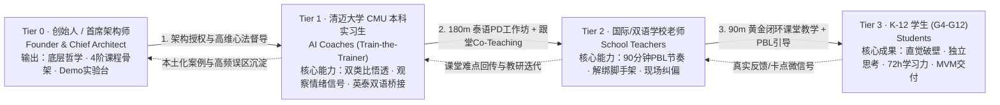

# CMU AI Coach 导师培养体系与 K-12 国际 AI 课程总设计方案（初稿）

> **文档定位**：交付创始人审阅的体系总纲 · 泰国清迈大学（CMU）本科实习生 AI Coach 培训手册（Train-the-Trainer）· 国际与双语学校 Teacher 一线教学大纲  
> **适用范围**：泰国清迈、曼谷及东南亚/中国国际学校与双语学校（Grades 4–12 / ป.4–ม.6，衔接 IB / IGCSE / AP / AI4K12）  
> **语言设计**：主体分析与教案采用**简体中文**；核心开场白、双类比剧本、课堂 7 大干预话术及指令词卡均提供 **简体中文 · English · ภาษาไทย（泰语）** 三语精准对照，确保 CMU 实习生能够直接以泰语悟透原理，并用英/泰双语赋能一线教师。  
> **本地配套实验台**：[showcase hub](file:///Users/jason/Dev/jhfnetboy/animation/index.html) · `Demo 1A` 兰纳白象 · `Demo 1B` 深海巨鲸 · `Demo 2` Motion Canvas 课件 · `Demo 3` 物理沙盒与 72h 炼金炉

---

## 目录导航

- [模块一：三级赋能架构与 CMU 实习生 Coach 培训手册（Train-the-Trainer）](#模块一三级赋能架构与-cmu-实习生-coach-培训手册train-the-trainer)
  - [1.1 三级传递模型与三维认知视角差](#11-三级传递模型与三维认知视角差)
  - [1.2 Coach 标准开场白与核心双类比剧本（中 / EN / 泰 三语逐字稿）](#12-coach-标准开场白与核心双类比剧本中--en--泰-三语逐字稿)
  - [1.3 七大课堂观察与干预法则（The 7 Golden Coaching Rules）](#13-七大课堂观察与干预法则the-7-golden-coaching-rules)
  - [1.4 CMU 实习生对学校教师的 180 分钟泰语师资工作坊议程表](#14-cmu-实习生对学校教师的-180-分钟泰语师资工作坊议程表)
- [模块二：国际教育标准、PBL 3.0 与名校公开课权威溯源矩阵](#模块二国际教育标准pbl-30-与名校公开课权威溯源矩阵)
  - [2.1 PBLWorks Gold Standard PBL（PBL 3.0）与四阶体系咬合矩阵](#21-pblworks-gold-standard-pblpbl-30与四阶体系咬合矩阵)
  - [2.2 UNESCO AI Competency Framework (2024) 师生双维度映射](#22-unesco-ai-competency-framework-2024-师生双维度映射)
  - [2.3 AI4K12 · ISTE · IB MYP/DP 国际校标准与学术诚信护栏](#23-ai4k12--iste--ib-mypdp-国际校标准与学术诚信护栏)
  - [2.4 Stanford / CMU / MIT / Google 公开课与免费工具权威溯源图谱](#24-stanford--cmu--mit--google-公开课与免费工具权威溯源图谱)
- [模块三：四阶课程体系完整明细（Touching → Driving → Making → Enhancing）](#模块三四阶课程体系完整明细touching--driving--making--enhancing)
  - [3.0 四阶 12 单元全景地图与 K-12 分层深浅策略](#30-四阶-12-单元全景地图与-k-12-分层深浅策略)
  - [Level 1 · Touching（触碰与驾校理论/副驾示范）：Units 1–3](#level-1--touching触碰与驾校理论副驾示范units-13)
  - [Level 2 · Driving（路驾与逐步解绑约束）：Units 4–6](#level-2--driving路驾与逐步解绑约束units-46)
  - [Level 3 · Making（改装厂分流：3A Adjusting 黄金调校层 vs 3B Building 造引擎层）：Units 7–10](#level-3--making改装厂分流3a-adjusting-黄金调校层-vs-3b-building-造引擎层units-710)
  - [Level 4 · Enhancing（车队指挥与人类护城河）：Units 11–12](#level-4--enhancing车队指挥与人类护城河units-1112)
- [模块四：Teacher 一线课堂标准教案模板（可直接打印/复制使用）](#模块四teacher-一线课堂标准教案模板可直接打印复制使用)
  - [4.1 标准 90 分钟单课教案模板（整合 PBL 3.0 + 四阶解绑 + Coach 巡场检核）](#41-标准-90-分钟单课教案模板整合-pbl-30--四阶解绑--coach-巡场检核)
  - [4.2 三语课堂高频指令词卡（Classroom Command Cheat Sheet）](#42-三语课堂高频指令词卡classroom-command-cheat-sheet)

---

<a id="模块一三级赋能架构与-cmu-实习生-coach-培训手册train-the-trainer"></a>
# 模块一：三级赋能架构与 CMU 实习生 Coach 培训手册（Train-the-Trainer）

> **本模块使命**：解决 AI 教育落地国际/双语学校的最大瓶颈——**“老师自己没玩透 AI，一进机房就按传统软件课教按钮；或者光顾着自己演示酷炫结果，忽略了底下学生发呆、盲从或畏难。”** 清迈大学（CMU）本科实习生不是普通助教，而是被授权进入学校赋能一线教师的 **AI Coaches（教练型导师）**。

---

## 1.1 三级传递模型与三维认知视角差

### 1.1.1 三级赋能传递链（Cascade Enablement Architecture）



### 1.1.2 破局核心：Student vs. Teacher vs. Coach 的三维视角差

CMU 实习生在走进学校前，必须彻底完成一次**认知升维**。如果一个 CMU 计算机系大三大四学生只展示“我写 Prompt 多厉害、我跑 Python 多快”，那他充其量是一个**高级 Student**，根本做不了 **Coach**。

| 角色层级 | 核心关注焦点（What they look at） | 常见局限与盲区 | 跃迁后的高维定位（Target Mindset） |
| :--- | :--- | :--- | :--- |
| **Student（学生）** | **“怎么操作工具尽快出结果？”**<br>盯着输入框、复制答案、追求画面酷炫、逃避报错。 | 容易把 AI 当成魔法黑箱或偷懒机器；遇到报错就卡死，或者盲信 AI 生成的幻觉。 | 从“答案消费者”转变为“懂机械原理的驾驶员与提问者”。 |
| **Teacher（一线教师）** | **“知识讲完没有？课堂纪律稳不稳？学生作品交齐没？”**<br>习惯按教案 PPT 线性推进，最怕自己答不上来或课堂失控。 | 一旦学生出现“迷茫、乱玩、AI 报错”，老师容易出于焦虑直接代劳操作，或严令禁止自由尝试。 | 从“唯一标准答案权威”转型为 **PBL 引导师（Guide）**，敢于说“好问题，我们一起盘问 AI”。 |
| **CMU AI Coach（高一维导师）** | **站在“元认知与心理观测站（Metacognitive Observatory）”**：<br>不只看屏幕上的输出，更在扫描**全班 20 张脸的认知情绪微信号**！ | *新手实习生常犯错*：站在学生背后抢过鼠标直接帮他改好 Prompt（剥夺思考权）；或只用学术英文术语轰炸泰国老师。 | **诊断师 + 赋能者**：① 用泰语把硬核机制讲成清迈日常；② 培训老师实时读懂“迟疑/迷惑/盲从/挫败/炫技”；③ 精准控制“何时示范、何时闭嘴等 7 秒、何时给半成品支架、何时故意给陷阱制造冲突”。 |

> **Coach 心法铁律（Coach's Prime Directive）**：
> - **永远不要替老师或学生“把方向盘抢过来开”**；你的双手放在背后，只用手指屏幕提问或调整他们的后视镜。
> - **沉默 7 秒法则**：当老师抛完问题或学生卡壳时，强迫自己和老师在心里默数 7 秒（Thai: นับในใจ 7 วินาที），把认知挣扎的空间还给大脑。

---

## 1.2 Coach 标准开场白与核心双类比剧本（中 / EN / 泰 三语逐字稿）

> **使用说明**：本节为 CMU 实习生在 **教师工作坊（Teacher PD）** 或 **示范课前 8 分钟** 必背并内化的标准讲稿。要求泰语版口语自然流畅、带温度（用 `ครับ/ค่ะ` 依据讲者性别自行微调，文稿以通用礼貌体 `ครับ/ค่ะ` 标注），英语版适合国际学校直接上台呈现。

### Part A：时代定调与核心原则——“拥抱科技的同时，保持独立思考”

#### 🇨🇳 简体中文（标准理解与内部校准版）
> “各位老师、同学们，大家好。今天我们不把 AI 当作一门枯燥的电脑操作课来学。首先请大家抬头想一个问题：**AI 究竟是什么？**  
> 在人类过去几千年的历史里，我们发明过蒸汽机、电力和互联网，但 **AI 是人类历史上第一个、也是最重要的‘智能工具’**。它的潜力几乎没有天花板——随着参数与连接不断演化，未来它甚至可能涌现出超越一般工具的智慧形态，成为人类文明史上前所未有的一种**‘数字生命（Digital Life）’**。  
> 面对这样一场技术巨浪，逃避或禁止是没有用的，盲目崇拜更是危险的。我们给当代年轻人只有一句最核心的战略建议：**在全心拥抱科技的同时，死死守住人类的独立思考。** 工具负责提供无穷的算力，而提问的方向、审美的品味和价值的判断，永远掌握在你手里。”

#### 🇬🇧 English (International School Delivery Script)
> "Good morning everyone. Today, we are not learning AI as a dry computer-button tutorial. Let’s pause and ask a bigger question first: **What really is AI?**  
> Throughout human history, we invented steam engines, electricity, and the internet. Yet **AI is the single most important intelligent tool humanity has ever created**. Its potential is boundless—as scale and reasoning evolve, it may eventually give rise to forms of intelligence beyond a mere tool, resembling a new kind of **'digital life'** co-existing with us.  
> Facing a wave this huge, running away or banning it will fail, and worshipping it blindly is dangerous. There is only one golden compass for young people today: **Embrace technology wholeheartedly, while fiercely guarding your independent thinking.** AI brings infinite horsepower; you bring direction, taste, and judgment."

#### 🇹🇭 ภาษาไทย (บทพูดมาตรฐานสำหรับฝึกอบรมครูและเปิดคาบเรียนอย่างเป็นธรรมชาติ)
> "สวัสดีครับ/ค่ะ คุณครูและนักเรียนทุกคน วันนี้เราจะไม่ได้มาเรียน AI แบบท่องจำปุ่มกดในห้องคอมพิวเตอร์ที่แสนน่าเบื่อนะครับ/คะ แต่อยากชวนทุกคนหยุดคิดคำถามสำคัญหนึ่งข้อก่อน: **แท้จริงแล้ว AI คืออะไร?**  
> ตลอดประวัติศาสตร์มนุษยชาติ เราสร้างเครื่องจักรไอน้ำ ไฟฟ้า และอินเทอร์เน็ตมาแล้ว แต่ **AI คือ 'เครื่องมืออัจฉริยะ' ที่สำคัญที่สุดเท่าที่มนุษย์เคยสร้างขึ้น** ศักยภาพของมันแทบไร้ขีดจำกัด และในอนาคตเมื่อมันวิวัฒนาการต่อไป มันอาจก้าวข้ามความเป็นเครื่องมือธรรมดาไปสู่ภูมิปัญญารูปแบบใหม่ หรืออาจเรียกว่าเป็น **'ชีวิตดิจิทัล (Digital Life)'** รูปแบบหนึ่งที่อยู่ร่วมโลกกับเราก็ได้  
> เมื่อต้องเผชิญกับคลื่นเทคโนโลยีลูกใหญ่ขนาดนี้ การหนีหรือสั่งห้ามใช้ไม่มีทางได้ผล ส่วนการเชื่อตามแบบหลับหูหลับตาก็อันตรายเช่นกัน เข็มทิศสำคัญที่สุดสำหรับคนรุ่นใหม่จึงมีเพียงประโยคเดียวครับ/ค่ะ: **จงเปิดรับเทคโนโลยีอย่างเต็มที่ ควบคู่ไปกับการรักษา 'การคิดวิเคราะห์อย่างอิสระ (Independent Thinking)' ไว้ให้มั่น** เพราะเครื่องมือให้พลังขับเคลื่อนได้ไม่รู้จบ แต่มนุษย์อย่างเราคือผู้กำหนดทิศทาง คุณค่า และรสนิยมเสมอครับ/ค่ะ"

---

### Part B：双类比体系（一）：底层机制比喻——“复杂精密、会自我生长的齿轮系统”

| 语种 | 核心逐字稿（建议配合手指转动手势或打开 `Demo 3` 齿轮动画边指边讲） |
| :--- | :--- |
| **🇨🇳 中文** | “很多人以为 AI 脑袋里住着一个‘小人’，其实不是。从底层看，AI 是一套**极其复杂精密、而且会自我生长的齿轮系统（Self-Growing Precision Gear System）**。传统软件的齿轮是程序员一颗颗手工焊死的，写好 `1+1=2` 它就永远只转这一格；而 AI 这个齿轮箱，每读过人类几亿句话，内部数千亿颗微小的齿轮就会自动微调咬合角度、自己长出新的齿牙去匹配语言的规律。**但是请注意！**再精密的齿轮系统，不管它自己长出多少亿个齿轮，它本身并不知道‘为什么要转’，也不知道‘转出去对人类是好还是坏’——决定齿轮朝哪个方向咬合的，是站在机器外面的人。” |
| **🇬🇧 English** | "Many people imagine a tiny human brain sitting inside AI. Not true. Under the hood, AI is an **extraordinarily intricate, self-growing precision gear system**. In traditional software, engineers weld every single gear tooth by hand—fixed rules, zero growth. Inside AI, every time it absorbs billions of human sentences, hundreds of billions of micro-gears adjust their angles and literally grow new teeth to mesh with patterns of meaning. **Yet remember this:** no matter how massive or self-growing that gear train becomes, gears themselves have zero purpose. They don’t know *why* they spin or whether the output helps or harms people. The human standing at the control lever decides what the gears spin for." |
| **🇹🇭 ภาษาไทย** | "หลายคนคิดว่าในหัวของ AI มี 'คนตัวเล็กๆ' นั่งคิดอยู่ข้างใน จริงๆ แล้วไม่ใช่เลยครับ/ค่ะ เบื้องลึกของ AI คือ **ระบบฟันเฟืองที่ซับซ้อน ประณีต และสามารถ 'เติบโตงอกงามได้ด้วยตัวเอง' (Self-Growing Precision Gear System)** ซอฟต์แวร์ยุคเก่าเปรียบเหมือนฟันเฟืองที่โปรแกรมเมอร์เชื่อมตายตัวไว้ทีละซี่ สั่ง A ได้ B ไม่มีวันเปลี่ยน แต่ระบบฟันเฟืองของ AI นั้น ทุกครั้งที่มันอ่านข้อมูลมหาศาลของมนุษย์ ฟันเฟืองจิ๋วนับแสนล้านตัวข้างในจะค่อยๆ ปรับองศาและงอกซี่ฟันใหม่ขึ้นมาขบกันเองตามรูปแบบของภาษาและข้อมูล **แต่ขอให้จำไว้ข้อหนึ่งนะครับ/คะ:** ต่อให้ระบบฟันเฟืองนี้ซับซ้อนและเติบโตเองได้เก่งแค่ไหน ตัวฟันเฟืองเองไม่มีวันรู้ว่า 'กำลังหมุนไปเพื่ออะไร' หรือ 'ผลลัพธ์นั้นดีหรือร้ายต่อเพื่อนมนุษย์' คนที่กำหนดเป้าหมายว่าฟันเฟืองจะหมุนไปทางไหน ก็คือตัวเราครับ/ค่ะ" |

---

### Part C：双类比体系（二）：教学主线比喻——“智能汽车与驾校四阶晋级体系”

> **创始人关键教学判断（必须对老师和学生讲透，消除“不会写代码训练大模型就会被淘汰”的焦虑）**：
> 在 **Touching ➔ Driving ➔ Making（Adjusting / Building）➔ Enhancing** 的进阶地图里，**绝大多数普通人、教师、跨学科创作者与职场骨干，只要扎扎实实到达 `Making - Adjusting（调校与组装应用层）`，就已经完全足够在未来 AI 社会安身立命、创造极高价值！** 只有极少数立志造发动机或从事底层科研的同学，才需要继续深入 `Making - Building（造引擎层）`。

| 阶段定位 | 🇨🇳 中文教学隐喻 | 🇬🇧 English Metaphor | 🇹🇭 ภาษาไทย (คำอุปมาสำหรับครูและนักเรียน) |
| :--- | :--- | :--- | :--- |
| **Stage 1: Touching**<br>（触碰与驾校理论） | **驾校拆车看原理 + 坐副驾试乘**：先打开发动机盖摸一摸里面怎么点火（Token/Attention/概率），再坐到副驾看教练开一圈，明白车很猛但也有视觉盲区。 | **Theory Class & Co-Pilot Ride**: Pop the hood to see how the engine sparks, then ride shotgun to feel both the AI’s horsepower and its dangerous blind spots. | **ภาคทฤษฎี & นั่งข้างคนขับ**: เปิดฝากระโปรงดูเครื่องยนต์ให้เข้าใจกลไก แล้วลองนั่งเบาะข้างดูครูฝึกขับ เพื่อสัมผัสทั้งความแรงและ "จุดบอด" ของรถ |
| **Stage 2: Driving**<br>（路驾与渐进解绑） | **考驾照上路，一步步拆掉辅助刹车**：先在有明确规则的教练场练车，再去掉限制跑进山路，在陌生领域 72 小时安全越野，学会边看仪表盘边独立判断。 | **Hands on the Wheel & Removing Training Wheels**: Start in a guarded driving lot, gradually lift constraints onto open highways, and navigate unfamiliar terrain in 72 hours. | **จับพวงมาลัย & ปลดล็อกข้อจำกัดทีละขั้น**: เริ่มจากสนามฝึกที่คุมความเร็ว แล้วค่อยๆ ถอดล้อประคองออกสู่ถนนจริง จนสามารถขับลุยพื้นที่ใหม่ๆ ได้ภายใน 72 ชั่วโมง |
| **Stage 3A: Making – Adjusting**<br>（改装厂：黄金调校层 ★） | **开进汽车改装厂调校应用（黄金终点线！）**：你不必会自己冶炼钢铁造内燃机，但你会给车装上专属地图（**RAG**）、加装机械臂（**Agent Tools**）、调校悬挂和驾驶性格（**Prompt/工作流**）。**90% 的普通人与未来高价值岗位，走到这里就已足够叱咤风云！** | **The Custom Tuning Garage (The Golden Sweet Spot ★)**: You don't need to smelt steel to build an engine block. You install custom GPS (**RAG**), robotic arms (**Agent Tools**), and tune suspension (**Workflows**). **Reaching Adjusting is more than enough for 90% of careers to thrive!** | **อู่แต่งรถ: ปรับจูนและประกอบใช้งาน (จุดทองคำที่เพียงพอต่ออนาคต ★)**: คุณไม่จำเป็นต้องหลอมเหล็กสร้างเครื่องยนต์เอง แต่คุณติด GPS ข้อมูลเฉพาะตัว (**RAG**), ติดแขนกลเครื่องมือ (**Tools**), และจูนระบบให้เข้ากับงานจริง (**Workflows**) **คนส่วนใหญ่เก่งถึงระดับนี้ก็เพียงพอสร้างคุณค่าและเลี้ยงชีพได้อย่างมั่นคงแล้วครับ/ค่ะ!** |
| **Stage 3B: Making – Building**<br>（造引擎工程极客层） | **进发动机研发车间造引擎**：适合对硬核数学与底层工程上瘾的少数派——亲自收集原油数据、用工具试着训练分类模型、观察 Loss 下降与数据偏见。 | **The Engine Foundry (Deep Engineering Track)**: For curious builders who want to refine fuel and forge mini-engines—collecting data, training classifiers, and watching Loss curves drop. | **โรงงานสร้างเครื่องยนต์ (สายวิศวกรรมเชิงลึก)**: สำหรับผู้ที่หลงใหลเบื้องลึกทางเทคนิค—ทดลองเก็บข้อมูล ฝึกสอนโมเดลขนาดเล็กด้วยตนเอง และสังเกตค่าความคลาดเคลื่อน (Loss) รวมถึงอคติของข้อมูล |
| **Stage 4: Enhancing**<br>（车队指挥与交通伦理） | **无人驾驶车队指挥官 + 交通立法者**：你不再只开一辆车，而是指挥一支各司其职的 AI 车队（Multi-Agent），并在十字路口定下守住人类尊严与审美底线的交通法规。 | **Fleet Commander & Traffic Architect**: Step out of the single driver's seat to orchestrate an entire Multi-Agent convoy—while writing the human ethics and taste rules at every intersection. | **ผู้บัญชาการกองรถ & ผู้วางกฎจราจร**: ก้าวจากการขับรถคันเดียวไปสู่การคุมขบวนรถอัจฉริยะ (Multi-Agent) พร้อมออกแบบกติกาจริยธรรมเพื่อปกป้องศักดิ์ศรีของมนุษย์ |

---

## 1.3 七大课堂观察与干预法则（The 7 Golden Coaching Rules）

> **CMU Coach 核心训练任务**：在观摩学校教师上课时，Coach 必须手持此清单站在教室两侧，**既观察学生面部与鼠标动作，也观察老师有没有踩中“禁忌动作”**。每条法则均可直接拆成情景剧让老师在 PD 工作坊演练。

### 法则 1：应对【迟疑 / 畏难】（Hesitation · สัญญาณลังเล / ไม่กล้าพิมพ์）

- **课堂微信号**：双手离开键盘悬空、反复盯着空白输入框发呆超过 45 秒、把窗口最小化偷看邻桌屏幕、小声问老师“这样写对不对 / 会不会弄坏电脑？”
- **底层认知成因**：受传统“唯一标准答案”应试习惯压迫，害怕第一句话写得“不够专业”而丢脸；或面对空白画布产生启动阻力（Blank-Page Paralysis）。
- **教师常见禁忌动作**：① 催促“快点写啊大家都在等你”；② 直接凑过去抢过鼠标替学生打完一整段 Prompt。
- **Coach / Teacher 标准干预动作**：**递出“半成品副驾脚手架”（Co-Pilot Half-Baked Scaffold）**——告诉学生“方向盘先别想开去曼谷，我们只把车开出 5 米”。在黑板或聊天框给出一段**故意留两个空位的模板**，要求学生只填自己最熟悉的一个生活词，先看到车轮动起来。
- **三语示范话术**：
  - 🇨🇳 “在 AI 驾校里，第一句话从来不是‘交考卷’，而是‘按喇叭试音’。你不用写完美，先填进这两个词试试看，哪怕 AI 回复得很蠢，我们也有了第一块可以修改的积木！”
  - 🇬🇧 "In this driving school, your first prompt isn’t an exam paper—it’s just tapping the horn to test the circuit. Don't aim for perfection. Fill in just these two blanks and hit enter; even a silly AI reply gives us clay to sculpt!"
  - 🇹🇭 "ในโรงเรียนสอนขับรถ AI นี้ ข้อความแรกไม่ใช่ 'ข้อสอบที่ต้องถูก 100%' ครับ/ค่ะ แต่เป็นการ 'ลองบีบแตรเช็กเครื่อง' ไม่ต้องกลัวผิด ลองเติมแค่ 2 ช่องว่างนี้แล้วกดส่งเลย ต่อให้ AI ตอบเพี้ยน เราก็จะได้มีจุดเริ่มต้นให้ลองปรับแก้ไปด้วยกัน!"

---

### 法则 2：应对【迷惑 / 黑箱眩晕】（Confusion · สับสน / มึนงงกับศัพท์เทคนิค）

- **课堂微信号**：眉头紧锁、眼神失去焦距、机械地跟着点鼠标却说不出屏幕在干嘛、回答提问时直接背诵英文术语（如只说“因为 Embedding”）但无法用大白话解释。
- **底层认知成因**：抽象符号密度过高（如向量、Softmax、Attention 权重），大脑工作记忆过载，掉进了“黑箱魔法眩晕”。
- **教师常见禁忌动作**：用更多专业术语去解释一个专业术语（例如用“余弦相似度点积”去对中学生解释“Embedding”）。
- **Coach / Teacher 标准干预动作**：**强制切换“清迈生活类比 + 暂停动画单步拆解”**。立刻喊停操作，打开 `Demo 1A（兰纳白象）` 暂停在对应幕次，或切换到 `Demo 3` 模式 A 慢放，改用**清迈菜市场/水灯/双条车/弹珠机**比喻重新锚定直觉，要求学生用自己家乡的比喻复述一遍才准继续。
- **三语示范话术**：
  - 🇨🇳 “停！先把那些吓人的英文黑话丢出窗外。你看 `Demo 1A` 里的天灯——它们聚在一起不是因为学过数学，就像清迈夜市里卖芒果糯米饭的摊位自然聚在一条街一样。用你的话告诉我：‘语义靠近’在你生活里像什么？”
  - 🇬🇧 "Pause! Throw that scary jargon out the window for 30 seconds. Look at the sky lanterns frozen in `Demo 1A`—they cluster together not by magic math, just like mango sticky rice stalls naturally group along the same Chiang Mai street. In your own words, what feels like 'semantic closeness' in daily life?"
  - 🇹🇭 "หยุดพักสักครู่ครับ/ค่ะ! โยนศัพท์ภาษาอังกฤษยากๆ ทิ้งไปก่อน ลองดูภาพโคมยี่เป็งใน `Demo 1A` ที่เราหยุดค้างไว้สิครับ/ค่ะ โคมพวกนี้ลอยมาอยู่ใกล้กัน เหมือนร้านข้าวเหนียวมะม่วงในตลาดเชียงใหม่ที่มักจะตั้งอยู่โซนเดียวกันเลย ไหนลองอธิบายด้วยคำพูดบ้านๆ ของหนูสิว่า 'ความหมายใกล้เคียงกัน' มันเหมือนอะไรในชีวิตประจำวัน?"

---

### 法则 3：应对【盲从 / 偷懒复制】（Blind Trust · เชื่อ AI โดยไม่คิด / ก๊อปปี้ส่งงาน）

- **课堂微信号**：AI 输出还没滚动完就直接点击“复制”、脸上带着“任务完成”的轻松微笑、作品文字充斥 AI 腔调但本人连里面三个核心词都读不顺、完全不核查数字与事实来源。
- **底层认知成因**：认知懒惰（Cognitive Offloading）+ 对流畅文风的权威误判——大脑把“说得很自信、排版很工整”误认为“绝对正确”。
- **教师常见禁忌动作**：单纯道德说教“不许用 AI 作弊！”或用不靠谱的所谓 AI 检测器吓唬学生（易引发对抗与隐瞒）。
- **Coach / Teacher 标准干预动作**：**启动“苏格拉底追尾测试”（Socratic Rear-End Test）**。不骂学生，而是微笑着当场请学生输入一个**暗藏时空错位或本地冷知识陷阱的题**（或打开 `Demo 3` 模式 A 调高 Temperature 触发红色幻觉灯），让 AI 一本正经地编造假事实！接着让全班用“三源交叉验证铁律”现场抓现行。
- **三语示范话术**：
  - 🇨🇳 “别急着交作业！你现在是这辆车的副驾驶，但刚才 AI 闭着眼睛在单行道逆行了你还给它鼓掌。来，我们拿它刚刚给的这 3 个数据去 Google 学者和官方资料里做一次‘追尾测试’——谁抓出 AI 的胡说八道，谁今天拿最高分！”
  - 🇬🇧 "Hold on before submitting! You’re sitting in the driver’s seat, clapping while your AI autopilot just turned the wrong way down a one-way street. Let’s run a 'Rear-End Test' on these 3 facts using two real sources—highest points today go to whoever catches the AI red-handed!"
  - 🇹🇭 "เดี๋ยวก่อนครับ/ค่ะ อย่าเพิ่งรีบส่งงาน! ตอนนี้เราเป็นคนขับ แต่เมื่อกี้ระบบขับอัตโนมัติ AI ขับสวนเลนไปแล้วเรายังปรบมือให้มันอยู่เลย มาลองทำ 'บททดสอบจับโป๊ะ' เอาข้อมูล 3 จุดนี้ไปเช็กกับแหล่งอ้างอิงจริงกัน ใครจับได้ว่า AI แอบมั่วนิ่มตรงไหน รับคะแนนพิเศษไปเลยครับ/ค่ะ!"

---

### 法则 4：应对【挫败 / 报错崩溃】（Frustration · ท้อแท้ / เครียดเมื่อโค้ดหรือระบบพัง）

- **课堂微信号**：叹气、往后仰靠椅背抱胸、疯狂连续点击同一按钮导致死循环、情绪烦躁甚至想直接放弃任务换简单题目。
- **底层认知成因**：在传统“一次做对才算聪明”的教育环境下，把工具报错或 AI 理解偏误内化为“我太笨、我不适合学科技”。
- **教师常见禁忌动作**：① 说“我早就说过按我的步骤就不会出错”；② 一脸严肃帮忙修好却不解释排查思路（加深学生的无力感）。
- **Coach / Teacher 标准干预动作**：**当众示范“大声思考排障”（Think-Aloud Debugging）**。把这位学生的报错界面投屏（提前征得同意且以赞美其勇气为前提），老师/Coach 主动自嘲自己每天也遇上 10 次 AI 抽风，并出声念出三步排查思考链：“① 哪里卡住了？② 我给的条件哪里含糊了？③ 把问题切小一半再逼问 AI！”
- **三语示范话术**：
  - 🇨🇳 “太棒了！全班停下来恭喜他——他抓到了今天第一只野生 Bug！老实说我昨天用 AI 做网页时它也抽风了五次。别藏着报错，看我怎么‘审讯’它：先把红色报错原封不动贴回去，加一句‘不要重写全部，先用初中生听得懂的话告诉我哪一行逻辑撞车了’。”
  - 🇬🇧 "Awesome! Everybody pause and celebrate—he just caught our first wild Bug of the day! Honestly, AI tripped up on me five times yesterday too. Watch me interrogate this error out loud: copy the red error verbatim, and tell AI, 'Don't rewrite everything—explain in plain words which two gears clashed here.'"
  - 🇹🇭 "เยี่ยมมากเลยครับ/ค่ะ! ทุกคนหยุดดูแล้วปรบมือให้เพื่อนหน่อย เพื่อนเพิ่งจับ Bug ตัวแรกของวันได้สำเร็จ! บอกตามตรงเมื่อวาน AI ก็รวนใส่ครูตั้ง 5 รอบ มาดูวิธีที่ครู 'สอบสวน' มันกัน: ก๊อปข้อความ Error สีแดงนี้ส่งกลับไปแล้วสั่งว่า 'อย่าเพิ่งเขียนใหม่ทั้งหมด อธิบายให้เข้าใจง่ายๆ ก่อนว่าขั้นตอนไหนที่ชนกัน'"

---

### 法则 5：应对【炫技走偏】（Distraction · หลงทาง / มัวแต่เล่นลูกเล่นจนลืมโจทย์จริง）

- **课堂微信号**：花 25 分钟调整赛博朋克背景渐变色、让 AI 生成 20 张毫无关系的炫酷机械恐龙图、或者不断堆砌复杂功能却说不清“这东西到底解决了谁的什么麻烦”。
- **底层认知成因**：多巴胺即时反馈上瘾（AI 制造视觉奇观太容易），用“工具复杂度”掩盖“对真实世界需求的一无所知”。
- **教师常见禁忌动作**：只看表面酷炫程度给高分，无意中鼓励“华而不实的玩具项目”。
- **Coach / Teacher 标准干预动作**：**执行“价值刹车检查”（Value Brake Check / `#rightproblem`）**。请学生把屏幕合上 45 度角，在 30 秒内用一张便签纸回答三个问题：**谁痛苦？（Who）痛在哪一秒？（When）如果明天你的 AI 工具被断网，他们会不会找你急？（So What）** 过不了这三问，禁止继续加特效。
- **三语示范话术**：
  - 🇨🇳 “这辆改装车漆得真酷，像电影里的跑车！但我要踩一下‘价值刹车’：把屏幕盖下来一半，告诉我——如果是清迈早市卖水果的老奶奶，她坐在你这辆车里，哪一个按钮是她真的会每天按的？找不到那个按钮之前，先不准改霓虹灯！”
  - 🇬🇧 "Your paint job looks like a movie supercar—awesome! Now let’s hit the 'Value Brake': tilt your laptop screen halfway down and answer in 20 seconds—if the fruit vendor grandma at Chiang Mai morning market sat inside your app, which single button would actually save her tears today? No more neon glow until we find that button!"
  - 🇹🇭 "รถแต่งคันนี้สีสวยเท่มากเลยครับ/ค่ะ เหมือนรถแข่งในหนังเลย! แต่ครูขออนุญาตเหยียบ 'เบรกเช็กคุณค่า' นิดนึงนะ ลองพับหน้าจอลงครึ่งหนึ่งแล้วตอบภายใน 20 วินาที: ถ้าคุณยายขายผลไม้ตลาดเช้าเชียงใหม่มานั่งในแอปของคุณ ปุ่มไหนที่ช่วยแก้ปัญหาให้คุณยายได้จริงในชีวิตประจำวัน? ถ้ายังหาปุ่มนั้นไม่เจอ ห้ามแต่งไฟนีออนเพิ่มก่อนนะ!"

---

### 法则 6：渐进解绑四步法（Progressive Unbinding Protocol · การปลดล็อกข้อจำกัด 4 ขั้นตอน）

> **核心理念**：绝不“一上来就扔给学生一个空白 ChatGPT”，也绝不“12 节课永远锁死填空题”。Coach 必须监督老师按以下四步精确卸载脚手架：

| 解绑阶段 | 汽车类比 | Prompt 与环境约束设置 | 教师/Coach 控制动作 | 解绑晋级信号（何时拆掉这一层保护） |
| :--- | :--- | :--- | :--- | :--- |
| **Step 1：全副驾带飞**<br>*(Dual-Control Car)* | 教练手握副刹，学生只负责踩油门和转指定弯道 | 提供**全结构化模板**（已锁死 Role、目标与输出格式），仅留 2–3 个场景词填空 | 全屏投映统一节奏；Coach 确保无一人卡在启动页 | 学生能顺利完成 1 轮输出并能说出“AI 为什么这么接龙” |
| **Step 2：限速场地练车**<br>*(Gated Training Track)* | 拆掉副刹车，但保留场地雪糕筒与 40km/h 限速 | 给出**任务规则卡与边界约束清单**（必须包含“反面验证”与“字数/读者限制”），Prompt 自主撰写 | 巡场抽查学生是否加了“刹车指令”；故意丢入偏题挑战 | 学生遇到 AI 跑偏时，能主动修改约束词而非重开新对话 |
| **Step 3：开放道路导航**<br>*(Open Road w/ GPS)* | 上真实公路，学生自己决定换挡时机与超车路线 | 仅提供**任务目标与三源交叉验证标准**（如 `Demo 3` 模式 B 72h 破壁），自选多工具组合 | Coach 退到三步外，只在出现“盲从/炫技”微信号时介入提问 | 能独立将大问题拆成 3–4 步对话流，并主动抓出 1 处幻觉 |
| **Step 4：无人区盲驾越野**<br>*(Off-Road Expedition)* | 没有现成地图，自己探路、架桥与排障 | **零模板、零预设题目**，面对完全陌生的领域或真实社区痛点，72 小时构建可交互原型 | 教师转为“路演质询评委”，只追问底层逻辑、用户证据与伦理边界 | 能面对真实陌生用户测试，讲清自己作品的局限与下一步迭代 |

---

### 法则 7：泰-英双语认知桥接法（Thai-English Bridging · การเชื่อมโยงความเข้าใจ ไทย–อังกฤษ）

> **专为泰国清迈及东南亚国际/双语学校设计**：许多泰国本土教师或双语教师英文阅读没问题，但在面对“Tokenization、RAG、Self-Correction、Overfitting”等密集英文科技词汇时，容易产生**理解隔膜与开口恐惧**，导致课堂变成干巴巴念英文 PPT。

- **标准双步桥接动作（The 2-Step Bridge）**：
  1. **Step A（泰语顿悟 / Thai Intuition First）**：CMU 实习生先完全用自然的泰语生活意象（如 `กระทง`, `โคมยี่เป็ง`, `รถสองแถว`, `ช่างแต่งรถ`, `จับโป๊ะ`）陪老师把原理笑哈哈地聊透，确认老师眼里亮出“อ๋อ! เข้าใจแล้ว!（啊哈！我懂了！）”的光芒。
  2. **Step B（英泰对照指令卡交付 / Classroom English Handoff）**：再递上精炼的《课堂英文高频句式卡》（每个概念只配 2 句短而有力、小学生也听得懂的 Classroom English），让老师在国际部课堂也能自信开讲！

---

## 1.4 CMU 实习生对学校教师的 180 分钟泰语师资工作坊议程表

> **场景说明**：CMU AI Coach 团队（建议每组 2–3 名实习生：1 名主讲 Coach + 1–2 名巡场观察 Coach）前往合作国际/双语学校，对 8–20 位学科教师（覆盖科学、数学、人文、艺术与 ICT）开展半天 **3 小时（180 分钟）沉浸式师资赋能工作坊（Teacher PD Workshop）**。全程 **泰语为主干讲解 + 英文核心术语与指令卡演练**。

| 时间段 | 时长 | 模块名称（泰/中） | 核心任务与活动设计 | 主导角色与所需物料 | 验收达标信号（Exit Ticket） |
| :--- | :---: | :--- | :--- | :--- | :--- |
| **00–15m** | 15m | **破冰与时代定调**<br>*(เปิดมุมมองยุค AI)* | ① 泰语播放标准开场白（数字生命与“拥抱科技+保持独立思考”）；<br>② 抛出老师最焦虑的 1 个痛点投票：“学生用 AI 写作业怎么办？”；<br>③ 展示“自生长齿轮”与“驾校四阶图”，明确 **3A Adjusting 黄金终点线** 缓解技术焦虑。 | 主讲 Coach（泰语脱口秀式引导）<br>物料：四阶驾校海报、`index.html` 总控台 | 至少 80% 老师点头认同“教 AI 不是教写代码，而是当驾校副驾” |
| **15–45m** | 30m | **亲历“视觉祛魅”课堂**<br>*(สัมผัสประสบการณ์จริงผ่าน Demo 1–3)* | 让老师化身“学生”完整体验一次微缩版 Touching 课：<br>① 欣赏 `Demo 1A`（兰纳水灯/天灯/白象）泰语字幕版；<br>② 对比实测：在工具里输入同一句泰语 vs 英语，亲眼见证 **泰语 Token Tax 碎块现象**；<br>③ 操作 `Demo 3` Mode A 调高 Temp=2.2，亲手抓出“红灯幻觉”。 | 主讲 Coach + 巡场 Coach 故意制造“小报错”让老师感受挫败与排障 | 每位老师能用泰语向邻桌讲清“为什么 AI 会一本正经胡说八道” |
| **45–60m** | 15m | **角色升维：看穿 7 大微信号**<br>*(ฝึกสายตา Coach จับสัญญาณผู้เรียน)* | 揭示 **Student / Teacher / Coach 三维视角差**；播放 3 段预先录制的 1 分钟课堂模拟短片（迟疑发呆、盲从复制、炫技偏题），让老师抢答诊断原因并配对“7 大干预法则”。 | 全体 Coach<br>物料：《7 大黄金法则三语口袋卡》 | 老师能在 10 秒内识别“盲从复制”并喊出“苏格拉底追尾测试” |
| **60–75m** | 15m | **中场茶歇与非正式 Q&A** | 自由体验 `Demo 2` Motion Canvas 时间轴课件与 `Demo 3` Mode B 72h 炼金炉。 | 自由交流 | 收集老师针对本校学段（PYP/MYP/DP）的担忧 |
| **75–120m** | 45m | **跨学科教案共创与“渐进解绑”改造**<br>*(ออกแบบแผนการสอน 90 นาที)* | 老师按学段（小学/初中/高中）或学科分组，领取模块四标准教案模板，将自己下周要上的一节学科课（如历史、生物、英语写作、艺术）改造成 **“渐进解绑四步 + 价值刹车检查”** 教案。 | 巡场 Coach 贴身辅导（严禁代写！用提问引导老师做 `3A Adjusting` 设计） | 每组产出一份完整填写好的 90 分钟教案初稿（含 1 个陷阱测试题） |
| **120–160m** | 40m | **角色扮演与 5 分钟微型试讲（Micro-Teaching）** | 每组派 1 位老师上台试讲 5 分钟核心导入或干预环节；**其余老师与 CMU Coach 故意扮演“迟疑学生、盲从学生、炫技学生”现场挑刺**！讲完由 Coach 做 3 分钟“高光肯定 + 1 条微调建议”复盘。 | Coach 担任“恶魔学生”测试老师是否忍不住抢鼠标或直接给答案 | 试讲老师能成功克制住“帮学生写”的冲动，用出泰/英干预话术 |
| **160–180m** | 20m | **英泰双语指令卡授勋与跟堂排期**<br>*(ส่งมอบการ์ดคำสั่ง & นัดหมาย Co-Teaching)* | 发放《中/英/泰三语课堂指令速查卡》；确认下周 CMU Coach 进班跟堂陪跑（Co-Teaching）时间表与反馈机制，合影结业。 | 主讲 Coach + 校方教研主任 | 确定首轮进班试点的班级、日期与双师分工表 |

---

<a id="模块二国际教育标准pbl-30-与名校公开课权威溯源矩阵"></a>
# 模块二：国际教育标准、PBL 3.0 与名校公开课权威溯源矩阵

> **本模块使命**：为合作国际学校校长、IB/IGCSE/AP 课程协调员（Coordinator）以及教研委员会提供**经得起国际认证审核（CIS / WASC / IB）的学术溯源背书**，同时让 CMU Coach 清楚知道每一节中学生课堂的背后，究竟站在哪几座世界顶尖大学实验室与国际教育标准的肩膀上。

---

## 2.1 PBLWorks Gold Standard PBL（PBL 3.0）与四阶体系咬合矩阵

本课程拒绝把项目式学习做成“课后手工甜点（Dessert Project）”，而是将全球公认的 **PBLWorks Gold Standard PBL（PBL 3.0 黄金标准：以学生核心知识、深度理解与成功技能为中心，由 7 大核心项目设计要素 + 7 大高阶教学实践构成）** 深度焊死在 **Touching ➔ Driving ➔ Making ➔ Enhancing** 四阶齿轮上。

### A. 7 大核心项目设计要素（7 Essential Project Design Elements）四阶咬合表

| PBL 3.0 设计要素 | 权威内涵界定（PBLWorks） | 在四阶课程中的具体咬合机制与落点 |
| :--- | :--- | :--- |
| **1. Challenging Problem or Question**<br>*(挑战性问题或驱动性问题)* | 项目必须围绕一个有意义、符合最近发展区的真实问题或核心探究问题展开 | **Unit 3 / 5 / 9**：拒绝“用 AI 做一个计算器”式假题；强迫从清迈/本地社区痛点出发，使用 `#rightproblem` 锁定诸如“如何帮不识英文的兰纳手工艺老人对接海外买家”等真问题。 |
| **2. Sustained Inquiry**<br>*(持续探究)* | 学生经历“提问 → 查证 → 应用 → 再追问”的延伸周期，而非单次检索 | **Unit 4 / 6 / 7**：通过 **72 小时领域破壁循环** 与 **三源交叉验证**，从第一性原理拆解一路追问到 Open Problems，探究贯穿多个周次。 |
| **3. Authenticity**<br>*(真实性)* | 具备真实世界语境、行业工具标准或解决校外真用户的个人关切 | **Unit 5 / 9 / 12**：实地走出校园访谈真实利害关系人（手艺人、食堂阿姨、长辈），采用真实 Agent 工作流与 RAG 交付可运行原型（MVM）。 |
| **4. Student Voice & Choice**<br>*(学生话语权与选择权)* | 学生自主决定项目方向、工具路径与呈现形式，激发主人翁意识 | **Unit 5 / 6 / 9 / 10**：Driving 阶段自由选择 4 大领域（视觉/Vibe Coding/学术/效率）；Making 阶段支持 **3A Adjusting（应用调校）** 与 **3B Building（造引擎）** 自主分流。 |
| **5. Reflection**<br>*(元认知反思)* | 师生持续反思“学到了什么、怎么学的、探究效率如何” | **全周期每课最后 15 分钟 + Unit 3/8/11**：强制保留《AI 提示词与防踩坑审计日志》，并在 Agent 设计中专门加入 **Reflection（自我反思纠偏节点）**。 |
| **6. Critique & Revision**<br>*(批判性互评与修订)* | 基于标准给予、接收并使用同伴与专家反馈持续迭代产品 | **Unit 4 / 8 / 12**：设立“苏格拉底追尾互怼环节”与第 9 步“杀掉伪需求”听证会，先找 Bug 与幻觉再上线修改，彻底告别“一次提交制”。 |
| **7. Public Product**<br>*(公开产品交付)* | 向教室之外的真实受众展示、讲解或上线作品 | **Unit 12 Demo Day**：所有 MVM 原型面向校领导、家长及社区真实受访者进行 5 分钟路演与 2 分钟高压答辩。 |

### B. 7 大高阶项目式教学实践（7 Project Based Teaching Practices）与 Coach 协同映射

| PBL 3.0 教学实践 | Teacher 课堂动作 | CMU Coach 赋能与介入点 |
| :--- | :--- | :--- |
| **1. Design & Plan** | 使用《90 分钟标准教案模板》规划脚手架与真实场景连接 | 工作坊协助老师把传统学科单元（历史/科学/语言）改造为 4 阶任务 |
| **2. Align to Standards** | 显性对齐 IB PYP/MYP/DP、IGCSE、AP 或 AI4K12 学科目标 | 提供现成《国际标准对齐检核条目》，减轻老师写教案的行政负担 |
| **3. Build the Culture** | 营造“敢报错、敢质疑 AI、重证据而非重听话”的安全课堂文化 | 用 **法则 4（当众排障示弱）** 示范老师如何卸下“权威包袱” |
| **4. Manage Activities** | 精确把控 `15-25-35-15` 时间盒、分组角色与离线/脱敏检查点 | 负责计时提醒与切换 `Demo 1/2/3` 投影，保证 90 分钟绝不拖堂 |
| **5. Scaffold Student Learning** | 按 **法则 6（渐进解绑四步法）** 分批次提供半成品模板与演示实验台 | 巡场监测 **法则 1（迟疑）** 与 **法则 2（眩晕）**，即时递出生活类比卡 |
| **6. Assess Student Learning** | 采取过程性《AI 对话审计日志》+ 口头质疑答辩取代闭卷背诵 | 协助老师执行 **法则 3（苏格拉底追尾测试）**，识别盲从复制 |
| **7. Engage & Coach** | 从讲台走入桌间，以提问引导替代直接帮学生做 | **Coach 核心主阵地**：站在高一维心理观测站，示范“7 秒沉默等待” |

---

## 2.2 UNESCO AI Competency Framework (2024) 师生双维度映射

2024 年 8–9 月，联合国教科文组织（UNESCO）正式发布了两份里程碑式指南：**《AI Competency Framework for Students》（4 大维度 × 12 项核心能力 × Understand / Apply / Create 三阶）** 与 **《AI Competency Framework for Teachers》（5 大维度 × 15 项核心能力 × Acquire / Deepen / Create 三阶）**。本课程体系与 Coach 培训体系对其实现了完整覆盖：

| UNESCO 2024 核心维度 | 学生框架（12 项能力 / Understand→Apply→Create）在本课程的落地 | 教师框架（15 项能力 / Acquire→Deepen→Create）在 Coach 培训中的落地 |
| :--- | :--- | :--- |
| **1. Human-Centred Mindset**<br>*(以人为本心智)* | **Understand (Unit 3)**：确立“AI 是增强人类而非取代人类自主权”的底线；<br>**Apply (Unit 5/9)**：在真实田野调研中以人本痛点为锚（`#rightproblem`）；<br>**Create (Unit 11–12)**：保留 Human-in-the-Loop 人类最终否决权与创意导演权。 | **Acquire (PD 0–45m)**：打破“AI 抢老师饭碗/只会作弊”的恐惧，确立驾校教练心态；<br>**Deepen (Unit 4/5 跟堂)**：学会把传统知识传授外包给 AI 支架，腾出精力做情绪观察；<br>**Create (独立授课)**：重新定义课堂评价标准为“人类独立思考证明”。 |
| **2. Ethics of AI**<br>*(AI 伦理)* | **Understand (Unit 2/3)**：看懂数据偏见（Bias）、幻觉与多语种算力不平等（Token Tax）；<br>**Apply (Unit 6/10)**：执行三源交叉核查与泰国 PDPA / 中国 PIPL 隐私脱敏；<br>**Create (Unit 12)**：运用 MIT 伦理损益矩阵审查自己原型对间接人群的影响。 | **Acquire (PD 45–60m)**：掌握未成年人隐私保护与作业透明度底线；<br>**Deepen (法则 3/5)**：用苏格拉底追尾测试揭露幻觉与算法偏见，而非简单禁用；<br>**Create (Unit 12 评审)**：制定本校/本班分级《AI 使用伦理公约》。 |
| **3. AI Foundations / Techniques & Applications**<br>*(AI 基础技术与应用)* | **Understand (Unit 1–2)**：通过水灯/探照灯/弹珠沙盒直觉理解 Token/Embedding/Attention/Softmax；<br>**Apply (Unit 4–9)**：掌握结构化提示、72h 破壁、RAG 与 Agent 工具流；<br>**Create (Unit 10 3B)**：动手训练小型分类器，观察 Loss 与过拟合。 | **Acquire (PD 15–45m)**：借助泰语生活类比吃透大模型“概率接龙齿轮”机制；<br>**Deepen (PD 75–120m)**：区分 `3A Adjusting（调校应用）` 与 `3B Building（造引擎）` 边界，消除数学自卑；<br>**Create (Unit 7–9)**：搭建学科专属 RAG 助教辅助备课。 |
| **4. AI System Design / AI Pedagogy**<br>*(学生：系统设计 / 教师：AI 教学法)* | **Understand (Unit 7–8)**：拆解 RAG 知识库与 ReAct 工具闭环结构；<br>**Apply (Unit 9)**：结合本地社会需求设计并改装 MVM 交互系统；<br>**Create (Unit 11–12)**：编排 Multi-Agent 协作系统并接受冷启动检验。 | **Acquire (PD 75–120m)**：掌握“渐进解绑四步法”与 `15-25-35-15` 课堂节律；<br>**Deepen (PD 120–160m)**：运用 **7 大课堂观察与干预法则** 处理迟疑、迷惑与盲从；<br>**Create (跨学科教案)**：跨科目设计“AI 辅助探究 + 口头答辩防作弊”评价流。 |
| **5. AI for Professional Learning**<br>*(教师专属：AI 赋能专业成长)* | *(对应学生侧元学习能力)* 72 小时陌生领域极速破壁法（Unit 6），成为终身自我迭代学习者。 | **Acquire → Create**：利用 CMU Coach 提供的 Prompt 模板与三语指令卡，将教研备课、差异化分层作业生成时间压缩 60%，建立教师互助学习社群。 |

---

## 2.3 AI4K12 · ISTE · IB MYP/DP 国际校标准与学术诚信护栏

| 标准体系 | 关键条目与核心准则 | 本课程精准对接落点 |
| :--- | :--- | :--- |
| **AI4K12 五大概念**<br>*(AAAI & CSTA)* | ① **Perception（感知）** ② **Representation & Reasoning（表征与推理）** ③ **Learning（学习）** ④ **Natural Interaction（自然交互）** ⑤ **Societal Impact（社会影响）** | • 感知：`Demo 1A` 水灯切片 & Unit 10 图像/声音分类；<br>• 表征与推理：Unit 1 语义星海 + Unit 8 Agent ReAct 规划；<br>• 学习：Unit 2 齿轮生长 & Unit 10 Loss 梯度直觉；<br>• 自然交互：Unit 4/9 多语种 Token Tax 与人文共情设计；<br>• 社会影响：Unit 3/12 偏见审计与伦理矩阵。 |
| **ISTE Standards for Students** | **1.1 Empowered Learner** · **1.2 Digital Citizen** · **1.3 Knowledge Constructor** · **1.4 Innovative Designer** · **1.5 Computational Thinker** · **1.6 Creative Communicator** · **1.7 Global Collaborator** | 重点支撑 **1.3 知识建构者**（三源验证对抗幻觉）、**1.4 创新设计师**（Vibe Prototyping 与 MVM 迭代）、**1.5 计算思维者**（ReAct 问题分解与调试排障）。 |
| **IB PYP / MYP / DP** | • **IB AI 官方学术诚信原则**：**不禁止使用 AI**，但必须将 AI 视作**外部信源（External Source）**显性声明与引用；以过程追踪与口头质询验证真实作者身份（Authorship），不迷信 AI 文本检测器。<br>• **IB MYP Design Cycle**：A 调研分析 → B 构思设计 → C 创造方案 → D 评估测试。<br>• **IB DP 核心**：TOK 认识论、CAS 社区行动、EE 文献审计。 | • **强制《AI 协作声明与过程日志》**：所有提交作品须附带关键 Prompt 记录、修改痕迹与至少 1 次“我推翻 AI 错误建议”的证据；<br>• **MYP Design Cycle 全映射**：Unit 5/6 (Criterion A) → Unit 7/8 (B) → Unit 9/10 (C) → Unit 12 (D)；<br>• **DP TOK 完美素材**：Unit 1 多语种 Token Tax、Unit 2 概率 vs 真实理解之辩。 |

---

## 2.4 Stanford / CMU / MIT / Google 公开课与免费工具权威溯源图谱

> **重要原则**：绝不在中小学课堂直接灌输大学研究生公式，而是由教研团队完成**“降维可视化转化”**——把斯坦福/CMU/MIT 顶级公开课的思想内核，精准映射到四阶教学的每一个 Unit！

| 所属机构 | 公开课 / 官方项目名称（含官方入口） | 原生核心知识点与代表人物 | 在本课程中的降维转化与对应 Unit |
| :--- | :--- | :--- | :--- |
| **Stanford** | **CRAFT** (*Classroom-Ready Resources About AI for Teaching*)<br>`https://craft.stanford.edu/` (Stanford GSE & HAI) | 面向高中的跨学科“耐久 AI 素养”、**五步算法审计法**（提假设 → 采样本 → 统偏差 → 归因 → 改建议）、版权与社会公平 | **Unit 3 / 5 / 12**：直接转化其跨学科嵌入式教学法与算法偏见审计流程 |
| **Stanford** | **CS25: Transformers United**<br>(`web.stanford.edu/class/cs25/`, Christopher Manning 等) | Transformer 核心突破、Self-Attention 机制在语言/视觉/生物中的统一应用、Scaling 涌现现象 | **Unit 1 / 2 / 3**：把 Q-K-V 与涌现概念转化为 `Demo 1A` 金莲慧光/白象跃出与 `Demo 2` 探照灯比喻 |
| **Stanford** | **CS224N** (*NLP with Deep Learning*) & **CS324** (*Large Language Models*) | 词向量几何运算（`King - Man + Woman`）、BPE 分词、预训练与微调、LLM 能力边界/风险/幻觉与治理 | **Unit 1 / 2 / 3 / 9**：Word2Vec 向量加减天平（`Demo 2` L1）、Temperature 采样与系统边界（`Demo 3` Mode A） |
| **Stanford / DeepLearning.AI** | **CS329Z / Andrew Ng Agentic Design Patterns** | **Agentic 四大核心设计模式**：① Reflection（反思自纠）② Tool Use（工具调用）③ Planning（任务拆解）④ Multi-Agent Collaboration（多智能体协作） | **Unit 4 / 8 / 11**：直接构成 Level 2 追问循环、Unit 8 钢铁侠战甲（`Demo 2` L3）及 Unit 11 车队指挥骨架 |
| **CMU** | **CMU CS Academy** (`https://academy.cs.cmu.edu/`) | CS0 / CS1 / CS2 基于 **Python 图形化交互** 的中学计算机核心课，强调视觉即时反馈而非枯燥命令行 | **Unit 5 / 9 / 10**：启发课程的 **Vibe Coding** 视觉先行路线——先看画面反馈，再调参数与逻辑 |
| **CMU (LTI)** | **CMU 11-768: AI Agents** (`https://www.cmu-agents.com/`, Graham Neubig & Daniel Fried) & **CMU 11-711: Advanced NLP** + **LLM Agents MOOC 生态** (`https://agenticai-learning.org/`) | Agent 基础回路、Tool Calling、RAG 检索增强、Context & Memory 管理、规划分解、Multi-Agent 协调、Coding/Computer Use Agents | **Unit 6 / 7 / 8 / 11**：将研究生级的 RAG、Memory 分层、Planning 与 Multi-Agent 分工降维为“汽车改装厂 + 车队指挥”实操 |
| **MIT** | **MIT Media Lab: DAILy Curriculum** (`https://everyday-ai.org/` / `https://raise.mit.edu/`) | **“算法即观点”**、PB&J 算法视角实验、监督学习偏见体验、GAN 不插电对抗游戏、**Ethical Matrix（伦理损益矩阵）** | **Unit 3 / 10 / 12**：完整引入偏见数据对比实验与第 12 单元“利益相关方伦理矩阵” |
| **MIT** | **MIT 6.S191: Introduction to Deep Learning** (`https://introtodeeplearning.com/`) | 深度学习入门、损失函数（Loss）与梯度下降直觉、过拟合与泛化、生成式模型原理 | **Unit 10 (3B)**：剥离微积分，只保留“找山谷最低点（Loss 下降）”与“死背错题本（过拟合）”的直观图像 |
| **Google & 开源可视化** | **Google Teachable Machine** (`teachablemachine.withgoogle.com`)<br>**TensorFlow Playground** (`playground.tensorflow.org`)<br>**3Blue1Brown** (*Neural Networks / LLMs*) | 浏览器零代码训练图像/音频/姿态模型；拖拽调整神经网络层数与神经元观察分类边界；顶级数学与 Transformer 几何动画 | **Unit 1 / 2 / 10 (3B)**：Teachable Machine 与 TF Playground 作为 **3B 造引擎探索层** 核心免费实验平台 |

---

<a id="模块三四阶课程体系完整明细touching--driving--making--enhancing"></a>
# 模块三：四阶课程体系完整明细（Touching → Driving → Making → Enhancing）

---

## 3.0 四阶 12 单元全景地图与 K-12 分层深浅策略

### A. 12 个核心单元全景总览表（4 Levels × 12 Units）

| 阶段（Level） | 单元编号与名称 | 汽车 / 齿轮核心定位 | 对应本地实验台 | 核心交付物（Proof-of-Work） |
| :--- | :--- | :--- | :--- | :--- |
| **Level 1<br>Touching**<br>*(驾校理论与副驾)* | **Unit 1**：AI 的“眼睛”与语言地图（Token & Embedding） | 拆开化油器看燃料怎么切成颗粒 | `Demo 1A` (Act 1-2) / `Demo 1B` / `Demo 2` (L1) | 《三语 Token Tax 对比实测单》+ 概念星座手绘图 |
| | **Unit 2**：大脑引擎室（Attention 探照灯与概率弹珠幻觉） | 坐进引擎舱看火花塞点火与失火瞬间 | `Demo 1A/1B` (Act 3) / `Demo 2` (L2) / `Demo 3` (Mode A) | 《可控创造力 vs 零幻觉参数实验报告》 |
| | **Unit 3**：试乘副驾（AI 能力光谱、盲区与独立思考契约） | 副驾首次上路体验盲区与紧急制动 | `Demo 1A` (Act 4-5) | 《抓出 AI 1 个致命盲区案例卡》+ 独立思考宣言 |
| **Level 2<br>Driving**<br>*(路驾与渐进解绑)* | **Unit 4**：一级限速场驾照（结构化提示与追问纠偏双循环） | 在雪糕筒教练场练习加减速与倒车纠偏 | `Demo 3` (Mode A 雪球对照) | 《从 1.0 菜鸟 Prompt 进化到 3.0 反思流对照录》 |
| | **Unit 5**：二级道路驾驶（四大领域跨界实操） | 上真实公路：视觉 / 代码 / 学术 / 效率四车道 | `Demo 2` 课件结构演示 | 任选 2 条赛道交付《人机共创改进前/后对比件》 |
| | **Unit 6**：三级无人区越野（72h 陌生领域极速破壁） | 拆掉 GPS 与限速器，72 小时冲进陌生山路 | `Demo 3` (Mode B 工位 1-2) | 《72h 领域破壁四波侦察图谱》+ 三源核查审计单 |
| **Level 3<br>Making**<br>*(改装厂分流)* | **Unit 7 [3A 调校★]**：私家导航升级（RAG 私有知识库） | 给车加装高精度私人离线地图防迷路 | `Demo 2` (L3 RAG 模块) | 搭建 1 个可运行学科/社区专属问答知识库 |
| | **Unit 8 [3A 调校★]**：加装机械臂（Agent 钢铁侠战甲工具流） | 为汽车焊上雷达、手臂与刹车熔断器 | `Demo 2` (L3 完整闭环) | 《Agent 战甲蓝图》（≥3 Tools + 1 人类刹车点） |
| | **Unit 9 [3A 调校★]**：整车定制改装（System Prompt 与社会痛点 MVM） | 按真实乘客需求改装内饰与驾驶性格 | `Demo 1A` (Act 5) / `Demo 3` (Mode B 工位 3-4) | 基于街头访谈的可交互原型 **MVM v1.0** |
| | **Unit 10 [3B 造引擎]**：造一颗微型引擎（数据采集与模型训练实践） | 进发动机车间亲手提炼燃油并测马力 | Google Teachable Machine / TF Playground | 1 个自采集训练分类器 + 《Loss 与偏见投毒报告》 |
| **Level 4<br>Enhancing**<br>*(车队与伦理)* | **Unit 11**：车队指挥官（Multi-Agent 协同与人类护城河） | 从单车司机晋升为多车编队总调度 | `Demo 2` (L3) + 多角色编排板 | 3 角色 Multi-Agent 协同工作流与品味裁决记录 |
| | **Unit 12**：交通立法者与 Demo Day（MIT 伦理矩阵与路演） | 制定十字路口安全法规并公开领证上路 | 全部 Demo 综合展示母版 | 《MIT 伦理损益矩阵》+ 5 分钟路演与 2 分钟答辩 |

### B. K–12 三学段认知深浅标尺（同一 Unit 如何在 G4–6 / G7–9 / G10–12 分层落地）

- **Upper Primary（小学高段 G4–G6 / ป.4–ป.6，9–12 岁）**：**故事化 + 身体表演 + 零代码拖拽**（禁用线性代数与 API 代码，重点在破除“AI 是真活人”的迷信，建立安全使用习惯与好奇心）。
- **Middle School（初中段 G7–G9 / ม.1–ม.3，12–15 岁）**：**可视化参数实验 + 对比审计 + 结构化工作流**（操作 Temperature/Top-K、做算法偏见对比统计、画完整 RAG/Agent 架构图与单文件 HTML 原型）。
- **High School（高中段 G10–G12 / ม.4–ม.6，15–18 岁）**：**多语算力经济学 + 真实社会田野 + 硬核产品交付**（实测 Token Tax、理解 Softmax/余弦/Loss 工程权衡、严格遵守 PDPA/IB 学术引用搭建多工具 MVM 并接受校外真实用户测试）。

---

<a id="level-1--touching触碰与驾校理论副驾示范units-13"></a>
## Level 1 · Touching（触碰与驾校理论/副驾示范）：Units 1–3

> **阶段定位**：坐进驾校理论课堂与模拟副驾座。重点不是“炫耀 AI 多神奇”，而是**把黑箱外壳掀开给孩子看里面的齿轮**，同时立下“独立思考”的契约。

---

### Unit 1：AI 的“眼睛”与语言地图——Token 切块与语义星座

- **① 汽车 / 齿轮类比定位**：
  - **中文**：“给发动机加注标准化油滴（Tokenizer）”与“GPS 语义立交桥坐标网（Embedding）”。人看句子是一幅连贯画卷，但 AI 齿轮箱吞不下整幅画，必须先把文字切碎成标准编号齿轮块，再摆进宇宙地图里找邻居。
  - **English**: *Fuel Atomizer (Tokenizer) & Semantic GPS Grid (Embedding)* — The AI gear train cannot swallow whole sentences; it slices text into numbered fuel droplets and maps them onto a meaning sky.
  - **ภาษาไทย**: *หัวฉีดแยกเม็ดพลังงาน (Tokenizer) & แผนที่ดาว GPS แห่งความหมาย (Embedding)* — ฟันเฟือง AI กลืนประโยคยาวๆ ทั้งก้อนไม่ได้ ต้องหั่นคำเป็นชิ้นโทเคนเล็กๆ ก่อน แล้ววางพิกัดลงบนแผนที่จักรวาลตามความใกล้ชิดของความหมาย
- **② 权威内容来源**：
  - **AI4K12**：Big Idea 2（Representation & Reasoning 表征与推理）——计算机如何表征人类符号知识；
  - **Stanford CS224N / CS324**：BPE Subword Tokenization 机制、Word2Vec 向量几何空间运算（`Vector(King) - Vector(Man) + Vector(Woman) ≈ Vector(Queen)`）；
  - **UNESCO Students (2024)**：AI Techniques & Applications（Understand 级别：理解文本如何转化为机器可计算的数值表征）；
  - **PBL 3.0**：*Sustained Inquiry*（为什么 AI 数不清英文单词 `Strawberry` 有几个 `r`？由反常识疑问引爆探究）。
- **③ 核心教学概念与认知目标（区分 K-12 深浅）**：
  - **G4–G6（小学高段）**：知道 AI 不是像人一样“读懂故事”，而是把词切成小积木块并把意思相近的积木放进同一个抽屉；亲眼看懂泰文/中文和英文切出来的积木数量不一样。
  - **G7–G9（初中段）**：理解高频子词切分（Subword/BPE）为什么导致大模型出现数字母盲区；能用二维“特征天平”解释为什么 `国王 - 男人 + 女人 ≈ 女王`。
  - **G10–G12（高中段）**：实测 **多语种 Token Tax（词元税）**——理解非拉丁语系（泰语、中文）因词表切分碎片化导致的算力成本上升、上下文窗口缩短与低资源语言文化偏差。
- **④ 完整授课过程（Teacher 90 分钟标准教案）**：
  1. **引入（00–15m · 视觉悬念）**：全屏播放 `Demo 1A`（兰纳白象版）第 1–2 幕（水灯词韵 → 天灯星群，切换至泰语或双语字幕）。随后现场向任意聊天模型提问：“请问 `Strawberry` 里有几个字母 `r`？”或用泰语问一个拆字谜题，展示 AI 偶尔翻车答“2 个”的截图，抛出驱动问题：“聪明绝顶的 AI 为什么连小学一年级数数都会错？”
  2. **示范与解构（15–40m · 动画拆解）**：
     - 打开 `Demo 2` Lesson 1：先停在 **Slides PPT 模式** 讲“乐高积木切割机”隐喻，再点进 **Motion Canvas 动画** 逐步播放 Step 1（Tokenizer 激光切割 `AI shapes our future` 变成带 `#ID` 的积木）与 Step 2–3（4D 语义天平与矢量三角公式）。
     - 老师现场打开开源 Tokenizer 可视化网页（如 OpenAI Tokenizer / Tiktokenizer），把同一句“我想去清迈吃芒果糯米饭”分别用 **英文、中文、泰文** 粘贴进去，全班一起大声数各自被切成了多少个彩色块！
  3. **渐进解绑实操（40–75m · Step 1 全副驾 → Step 2 限速场）**：
     - *任务 A（G4-6 不插电+实验）*：6 人一组玩“词汇引力站位游戏”，老师喊出一个词（如“宋干节”），手举“水枪/清迈/大象/微积分”卡片的同学根据亲疏距离站到教室不同角落；
     - *任务 B（G7-12 实操）*：每人测算 3 组文化专有词（如 `ข้าวซอย` Khao Soi / `Loy Krathong` / 自己名字）在英泰中三语下的 Token 数量倍率，并在纸上或电子画板设计一张包含 8 个概念的“个人兴趣语义星座图”，标出哪两个看似无关的概念其实存在隐藏引力航线。
  4. **纠偏与总结（75–90m）**：每组派代表 60 秒分享自己测出的最高“泰语 Token Tax 倍率”或最意外的星座连线；教师点明“AI 眼里没有文字情绪，只有数字坐标与切块概率”。
- **⑤ Coach 巡场观察重点与高发误区预警**：
  - *观察重点（法则 2 迷惑眩晕）*：看学生在 `Demo 2` 出现“4D 向量坐标轴”时有没有眼神发直或把“数字编号 `#2048`”误以为是“词典排名”。
  - *高发误区预警*：学生误以为“Token 越多代表 AI 越聪明”。Coach 需立刻提示老师反问：“如果一句话被切成 20 块碎片而不是 4 块，对齿轮箱来说记忆负担是变轻了还是变重了？”
- **⑥ 配套本地实验台与外部免费工具**：
  - **本地实验台**：`demos/demo1-kujira-art/index.html`（Act 1 `水灯词韵` · Act 2 `天灯星群`）、`demos/demo1-whale-ocean/index.html`（Act 1–2 海洋归档对照）、`demos/demo2-motion-slides/index.html`（Lesson 1 Slides + Motion Canvas）。
  - **免费开源工具**：Tiktokenizer (`tiktokenizer.vercel.app`)、3Blue1Brown *But what is a GPT? Visual intro to transformers* (`3blue1brown.com`)。

---

### Unit 2：大脑引擎室——Attention 注意力探照灯与概率弹珠的幻觉秘密

- **① 汽车 / 齿轮类比定位**：
  - **中文**：“多束夜间转弯大灯（Self-Attention）”与“离心概率弹珠调速器（Softmax & Temperature）”。大灯照清前面哪根路标最关键，而调速器决定齿轮箱有多敢‘赌冷门出口’——开太猛就会甩尾冲出悬崖（幻觉）。
  - **English**: *Adaptive Cornering Headlights (Self-Attention) & Probability Marble Governor (Temperature)* — Headlights lock onto crucial context clues while the thermal valve governs how wildly the engine gambles on the next word.
  - **ภาษาไทย**: *ไฟหน้าส่องบริบทอัจฉริยะ (Self-Attention) & เครื่องพินบอลความน่าจะเป็น (Temperature)* — ไฟหน้าช่วยส่องว่าคำไหนเชื่อมโยงกับคำไหน ส่วนวาล์วอุณหภูมิเป็นตัวคุมว่าเครื่องยนต์จะ "เดาคำแบบระมัดระวัง" หรือ "ซิ่งสุดเหวี่ยงจนหลุดโค้ง (Hallucination)"
- **② 权威内容来源**：
  - **Stanford CS25: Transformers United**：Self-Attention Q-K-V 核心直觉与多头注意力分工；
  - **Stanford CS324 (LLMs)**：Autoregressive Decoding（自回归解码）、Sampling 策略（Temperature / Top-K）与幻觉成因；
  - **PBL 3.0**：*Critique & Revision*（通过控制变量实验对比“创造力”与“事实失真”的边界）。
- **③ 核心教学概念与认知目标（区分 K-12 深浅）**：
  - **G4–G6**：明白 AI 写作文不是提前打好草稿，而是一个字接一个字“猜下一个最可能的词弹珠”；温度高就像弹珠跳得欢、容易编鬼话，温度低就稳重老实。
  - **G7–G9**：掌握 Q-K-V“提问探照灯匹配线索钥匙”的直观含义；能解释“自回归雪球效应”——为什么第 1 个词猜歪了，后面会顺着错话越圆越离谱。
  - **G10–G12**：理解 Softmax 概率分布曲线变平/变陡与熵值（Entropy bits）变化；能够根据应用场景（法律合同审查 vs 科幻设定脑暴）主动设计解码约束。
- **④ 完整授课过程（Teacher 90 分钟标准教案）**：
  1. **引入（00–15m）**：出示两句只差最后一个词的英文句子：`The dog chased the bone because it was [hungry / tasty].`。请全班用手指指出 `it` 分别指向谁。引出问题：“单词之间隔了好几个词，齿轮箱怎么知道照向谁？”播放 `Demo 1A` Act 3（金莲慧光）或 `Demo 1B` Act 3（注意力探照灯）。
  2. **示范与解构（15–40m）**：
     - 切入 `Demo 2` Lesson 2 演示 `hungry → dog (88%)` 与 `tasty → bone (92%)` 探照灯束动态切换；
     - 接着打开 `Demo 3` **模式 A（概率弹珠高尔顿板）**，点击“💡 课堂小贴士”按照经典对比演示：先选“科学常识推理”，设 `Temp=0.15, Top-K=2`，点击 **⚡ 连发 50 颗**，看所有弹珠如激光束射入 `100℃`；再切换“历史事实问答”，猛拉 `Temp=2.0, Top-K=8`，让弹珠乱撞落入荒诞槽位触发 **🚨 幻觉警告灯变红**！
  3. **渐进解绑实操（40–75m · Step 2 限速场控制变量实验）**：
     - 学生两两搭档操作 `Demo 3` Mode A：
       - *实验 A（冰霜模式）*：调低 Temp 与 Top-K，记录信息熵变化与长尾概率占比；
       - *实验 B（自回归雪球陷阱）*：故意在底部槽位**手动点击一个偏差词进行第 1 轮接龙**，观察第 2、3 轮 AI 如何一本正经地把错话编成完整荒诞故事！
       - 随后迁移到真实 AI 对话窗：同一历史/科学问题，分别用“严谨科研约束 Prompt”和“脑洞大开风格 Prompt”测试输出差异。
  4. **纠偏与总结（75–90m）**：每组上交《可控创造力实验单》——说明“创意”与“幻觉”本质上是同一个概率齿轮在不同温度下的两副面孔。
- **⑤ Coach 巡场观察重点与高发误区预警**：
  - *观察重点（法则 3 盲从 + 法则 2 迷惑）*：部分学生看到红色幻觉灯亮起觉得很好玩，却无法把桌面上的“弹珠乱撞”和现实中 ChatGPT 输出完美排版假论文联系起来。
  - *高发误区预警*：误以为“把 Temperature 设为 0 就永远不会有幻觉”。Coach 提示老师追问：“如果训练数据本身就错了或概率最高的就是大众谣言，温度为 0 时弹珠会百分之百射进哪个槽？”
- **⑥ 配套本地实验台与外部免费工具**：
  - **本地实验台**：`demos/demo1-kujira-art/index.html`（Act 3 `金莲慧光`）、`demos/demo2-motion-slides/index.html`（Lesson 2 `Self-Attention`）、`demos/demo3-mechanical-sandbox/index.html`（Mode A 完整物理沙盒）。
  - **免费开源工具**：Transformer Explainer (`poloclub.github.io/transformer-explainer/`)、3Blue1Brown Attention 可视化片段。

---

### Unit 3：试乘副驾——AI 能力光谱、盲区红线与“独立思考”契约

- **① 汽车 / 齿轮类比定位**：
  - **中文**：“副驾体验课——摸清引擎马力上限与后视镜死角”。车能在直道狂飙 200 迈，但一进无标线泥泞小路（最新本地事实、道德判断、空间物理常识）就会冲进水沟——此时副驾不能闭眼睡觉。
  - **English**: *Shotgun Safety Check — Horsepower Limits & Blind-Spot Cones* — Great on paved highways, catastrophic on unmarked local dirt roads where human vigilance saves the day.
  - **ภาษาไทย**: *บทเรียนนั่งเบาะข้าง — รู้ขีดจำกัดความแรงและจุดบอดกระจกมองข้าง* — รถวิ่งทางตรงได้เร็วมาก แต่เมื่อเข้าซอยท้องถิ่นที่ไม่มีป้ายบอกทาง (ข้อมูลท้องถิ่น ข้อเท็จจริงล่าสุด หรือการตัดสินใจเชิงจริยธรรม) ถ้านั่งหลับตาก็ตกคูแน่นอน
- **② 权威内容来源**：
  - **UNESCO Students (2024)**：Human-Centred Mindset & Ethics of AI（Understand 级：识别 AI 能力边界与不可替代的人类判断权）；
  - **Stanford CRAFT**：五步算法审计思维启蒙；
  - **MIT DAILy Curriculum**：*Algorithms as Opinions*（打破技术绝对客观中立的神话）；
  - **IB Academic Integrity Policy**：将 AI 视为需审慎引用的外部资料源而非作者本人。
- **③ 核心教学概念与认知目标（区分 K-12 深浅）**：
  - **G4–G6**：分清哪些事 AI 比人强（快速翻译、找点子、改错别字），哪些事人类永远不能交出去（交真朋友、替自己做道德决定、核实身边真实情况）。
  - **G7–G9**：掌握 **“AI 三大致命盲区”**（时效与本地长尾盲区、因果伪装盲区、文化与语言偏见盲区），学会使用“三源交叉验证法”。
  - **G10–G12**：能系统评估某项社会或学科任务适合“人主导 AI 辅佐”还是“绝对禁止完全外包”，并签署具有个人约束力的《班级 AI 独立思考与学术透明契约》。
- **④ 完整授课过程（Teacher 90 分钟标准教案）**：
  1. **引入（00–15m）**：全屏播放 `Demo 1A` 第 4–5 幕（`白象醒觉` 破水而出 → `兰纳领航` 驶向素贴山金佛塔）。定格在最后一帧提问：“如果白象力量这么大，为什么船头还要站着掌舵的人？”
  2. **示范与解构（15–40m）**：老师现场上演一次 **“苏格拉底追尾测试”（法则 3）**——故意让 AI 回答一个关于“清迈某个刚开张三个月的小巷咖啡馆老板故事”或“虚构的泰北传统节日规定”。把 AI 编造得天花乱坠的假故事投影到大屏，然后用手机地图/官方网站 30 秒当场戳破！再引出“三源交叉验证铁律（官方档案 + 权威教材/论文 + 现场一手查证）”。
  3. **渐进解绑实操（40–75m · “AI 猎人捉虫赛”）**：
     - 全班分为 4–5 组“AI 盲区质检队”，领取 4 类挑衅测试任务（本地冷门事实、多步空间物理逻辑、文化刻板印象测试、数学文字陷阱题）；
     - 学生必须在 25 分钟内用自己写的测试题**成功诱使 AI 翻车至少 2 次**，截图保存证据并标出错误类型（幻觉编造 / 时效过时 / 文化偏见 / 逻辑断裂）。
  4. **纠偏与总结（75–90m）**：评选“今日最佳捉虫猎人”；全班朗读并签署电子/纸质版《AI 独立思考契约》——**拥抱科技，但我的大脑永远不下车**。
- **⑤ Coach 巡场观察重点与高发误区预警**：
  - *观察重点（法则 1 迟疑 + 法则 3 盲从）*：很多平时乖巧的“好学生”不敢故意给 AI 出陷阱题，总想问正经问题。Coach 要像啦啦队长一样鼓励：“今天你的任务就是当挑剔的驾校考官，专门找这辆车哪里漏油！”
  - *高发误区预警*：部分学生捉虫成功后走向另一个极端：“既然 AI 会撒谎，那它就是垃圾，我以后不用了。”Coach 须立刻拉回“拥抱科技的同时保持独立思考”的平衡态。
- **⑥ 配套本地实验台与外部免费工具**：
  - **本地实验台**：`demos/demo1-kujira-art/index.html`（Act 4 `白象醒觉` & Act 5 `兰纳领航`）、`demos/demo1-whale-ocean/index.html`（Act 4–5 对照）。
  - **免费开源工具**：Google Fact Check Explorer、Wikipedia Citation 溯源练习、Stanford CRAFT 开源算法审计工作表 (`craft.stanford.edu`)。

---

<a id="level-2--driving路驾与逐步解绑约束units-46"></a>
## Level 2 · Driving（路驾与逐步解绑约束）：Units 4–6

> **阶段定位**：正式握住方向盘上路！通过 **3 级渐进解绑约束**（一级限速场 → 二级四赛道公路 → 三级 72 小时无人区越野），让学生在**“实验 ➔ 反馈 ➔ 独立思考”**的高频循环中告别“一句话盲抽许愿式提问”。

---

### Unit 4：一级限速场驾照——结构化提示工程与“追问-纠偏”双循环

- **① 汽车 / 齿轮类比定位**：
  - **中文**：“在驾校限速场地练稳换挡与倒车”。普通人用 AI 像闭眼乱踩油门（只输五个字就怪车不好开）；会驾驶的人懂得用**仪表盘四件套（角色-目标-边界-反例要求）**控速，并且车头歪了立刻微调方向盘（反思纠偏）。
  - **English**: *Gated Driving Track — Steering Precision & Closed-Loop Correction* — Moving from one-shot wishful prompting to structured constraints and iterative course correction.
  - **ภาษาไทย**: *สนามฝึกขับรถจำกัดความเร็ว — คุมพวงมาลัยด้วยโครงสร้างคำสั่งและวงจรปรับแก้* — เลิกการพิมพ์สั้นๆ แบบเสี่ยงดวง แล้วหันมาใช้กรอบคำสั่ง 4 ส่วนพร้อมการซักถามตรวจสอบซ้ำจนได้งานคุณภาพ
- **② 权威内容来源**：
  - **Stanford / Andrew Ng Agentic Design Patterns**：*Reflection Pattern（反思自检模式）* 思想的人工前置落地——不要把第一轮草稿当终稿；
  - **Minerva HCs**：形式分析与论证结构审查（区别前提、推论与反例）；
  - **PBL 3.0**：*Scaffold Student Learning*（Step 1→Step 2 脚手架渐变卸载）与 *Critique & Revision*。
- **③ 核心教学概念与认知目标（区分 K-12 深浅）**：
  - **G4–G6**：学会用“**你是谁 + 帮我做什么 + 谁要看 + 千万别做什么**”4 句口诀指挥 AI；懂得至少要跟 AI 来回聊 3 轮才能打磨出好点子。
  - **G7–G9**：掌握结构化 Prompt（Role / Context / Constraints / Output Format / Negative Rules）以及 **“红蓝对抗追问法”**（让 AI 自己扮演挑刺评委给上一轮输出打分并找出 3 个漏洞）。
  - **G10–G12**：能够设计多轮迭代状态流（Chain-of-Draft → Critique → Verify → Refine），主动设置 **Few-Shot 示例锚定** 控制输出风格与逻辑严密性，避免自回归误差放大。
- **④ 完整授课过程（Teacher 90 分钟标准教案）**：
  1. **引入（00–15m）**：展示两份对比鲜明的 AI 对话截图——左屏输入“写一篇清迈环保作文”生成的空洞套话（1.0 菜鸟盲抽）；右屏通过 3 轮约束与自检改写生成的细腻调查提纲。提问：“同样的齿轮箱，为什么右边开出了赛车质感？”
  2. **示范与解构（15–40m）**：
     - 老师打开 `Demo 3` Mode A 简要回顾“如果第 1 轮输出方向偏了一点，自回归雪球就会越滚越歪”；
     - 在大屏展示 **“驾驶四步方向盘模板”** + **“追问纠偏三连击”**（① 请你当严厉审稿人挑出上面回答的 3 个漏洞；② 用生活比喻重讲第 2 点；③ 列出最可能出错的事实等待我核对）。
  3. **渐进解绑实操（40–75m · 从 Step 1 全副驾过渡到 Step 2 限速场）**：
     - *Round 1（15 分钟 · Step 1 全副驾）*：用老师发的半成品四件套模板完成一个真实学科难题解释，但必须保留空白约束位自己填写；
     - *Round 2（20 分钟 · Step 2 限速场解绑）*：撤掉模板！只给三条硬性限速规则——① 必须逼 AI 先向你反问 3 个澄清问题才能动笔；② 必须要求它自检 1 个反例；③ 禁止出现空洞形容词。完成后同桌互换对话截图“找茬打分”。
  4. **纠偏与总结（75–90m）**：展示 2 份从“烂输出”被学生硬生生调教成“惊艳输出”的完整对话进化录，强化认知：**Prompt 不是一次性许愿咒语，而是不断纠偏的驾驶动作！**
- **⑤ Coach 巡场观察重点与高发误区预警**：
  - *观察重点（法则 1 迟疑 & 法则 4 挫败）*：当第 2 轮撤掉模板要求自己写约束时，部分学生会突然卡住发呆，或者因为 AI 第一轮没听懂而烦躁重开新窗口。Coach 要引导老师示范“接着聊、直接骂它哪里不对并给例子”的连续修正动作。
  - *高发误区预警*：学生把“写得很长、客套话很多”当成好 Prompt，忽略了真正决定质量的是**负向约束（不许做什么）**与**示例锚定（Few-Shot）**。
- **⑥ 配套本地实验台与外部免费工具**：
  - **本地实验台**：`demos/demo3-mechanical-sandbox/index.html`（Mode A 3 轮自回归接龙区展示初始漂移后果）。
  - **免费开源工具**：Anthropic Prompt Library / OpenAI Prompt Engineering Guide（精简卡片版）。

---

### Unit 5：二级道路驾驶——四大领域跨界实操（视觉设计 · Vibe Coding · 学术研究 · 个人效率）

- **① 汽车 / 齿轮类比定位**：
  - **中文**：“正式拿到路驾资格，开上四条不同路况的真实公路”——审美设计山路（重品味）、Vibe Coding 工程高速（重闭环调试）、学术探索国道（重证据链）、个人效率通勤道（重工作流减负）。
  - **English**: *Multi-Terrain Highway Driving* — Navigating 4 distinct real-world lanes: Visual Design, Vibe Coding, Academic Inquiry, and Personal Productivity without losing the driver’s human taste.
  - **ภาษาไทย**: *การขับรถบนถนนจริง 4 เส้นทาง* — ฝึกบังคับรถ AI ข้าม 4 สายงาน: การออกแบบภาพ (Visual), การสร้างต้นแบบด้วยภาษาธรรมชาติ (Vibe Coding), การวิจัยวิชาการ (Academic) และการจัดการชีวิต (Productivity) โดยไม่ทิ้งรสนิยมของมนุษย์
- **② 权威内容来源**：
  - **CMU CS Academy** (`academy.cs.cmu.edu`)：图形化与即时视觉反馈优先的编程启蒙理念；
  - **Alpha School**：用 AI 工具压缩机械重复学习时间、解放下午创造力的效率哲学；
  - **ISTE 1.4 / 1.6**：Innovative Designer & Creative Communicator；
  - **PBL 3.0**：*Student Voice and Choice*（在多领域赛道中选择并主导自己的表达）。
- **③ 核心教学概念与认知目标（区分 K-12 深浅）**：
  - **G4–G6**：体验用自然语言生成视觉故事板和单页面互动小卡片（如环保词汇翻翻卡），体会“我说想法、AI 画草图、我挑毛病改配色”。
  - **G7–G9**：跨界实操至少 2 个领域（如 **视觉设计 + Vibe Coding** 或 **学术研学 + 个人效率**），学会写 **“视觉品味纠偏词”**（不许用廉价渐变蓝紫、要有呼吸感与清晰字阶）以及单文件 HTML 报错回贴调试法。
  - **G10–G12**：掌握 **四大领域标准化“人机分工边界”**：视觉（人定艺术指导/AI 出变体）、Vibe Coding（人写 Intent Spec 规格与测试验收/AI 写代码）、学术研究（人定研究问题与核验原文/AI 做结构对比）、个人效率（人定时间优先级/AI 做错题诊断与日程编排）。
- **④ 完整授课过程（Teacher 90 分钟标准教案）**：
  1. **引入（00–15m）**：老师快闪展示 4 个震撼案例（全部由中学生用自然语言协作产出）：1 张清迈环保海报布局草图、1 个可交互单页物理小游戏（类似 `Demo 2` 视觉质感）、1 张跨学科文献对比表、1 个考前错题复盘工作表。提问：“这里面哪些动作只有人类能拍板，哪些动作是 AI 干的？”
  2. **示范与解构（15–40m · 四车道示范各 6 分钟）**：
     - **赛道 A（视觉设计）**：示范如何反对“AI 审美塑料感”，用具体材质/光影/留白词（如兰纳金箔与宣纸质感）指挥出图与排版；
     - **赛道 B（Vibe Coding）**：示范在浏览器本地跑一个零依赖单文件 HTML 小工具——故意改错一行让画面空白，然后当众执行 **法则 4（大声思考排障）** 贴报错修复；
     - **赛道 C（学术研究）**：示范用“只准引用我贴给你的两段资料、每句标来源段落号”防止瞎编文献；
     - **赛道 D（个人效率）**：示范把自己的真实周考错题拍照/抄录后，让 AI 当“苏格拉底错题医生”逐题反问而非直接吐答案。
  3. **渐进解绑实操（40–75m · Step 2 限速场 → Step 3 开放道路）**：
     - 4 人桌或个人自由选择 **1 个主攻赛道 + 1 个辅修赛道**（总计完成 2 个微任务），严禁只交“AI 第一稿”，必须保留**至少 2 轮人类介入修改记录**（如改掉 AI 俗气配色、修好 1 个互动逻辑 bug、删掉 1 条无证据学术论断）。
  4. **纠偏与总结（75–90m）**：开设“四车道展台画廊（Gallery Walk）”，学生互贴便签评价“哪里最看出人类品味，哪里还留着 AI 偷懒的痕迹”。
- **⑤ Coach 巡场观察重点与高发误区预警**：
  - *观察重点（法则 5 炫技走偏 + 法则 4 报错崩溃）*：Vibe Coding 组最容易因为网页突然白屏而全员举手崩溃；视觉设计组最容易陷入无休止抽卡炫技而忘了海报要传达什么信息。
  - *高发误区预警*：学生觉得“会用 AI 生成网页就是会 Vibe Coding 了”，却连自己要测试哪 3 个按钮都不知道。Coach 须引导老师追问：“如果明天给一个不识字的人点你这个网页，他第一步会卡在哪里？”
- **⑥ 配套本地实验台与外部免费工具**：
  - **本地实验台**：展示 `demos/demo2-motion-slides/index.html`（作为高质量交互微课网页的“审美与交互标杆”）及 `index.html`（单文件无后端架构示范）。
  - **免费开源工具**：HTML/JS 本地单文件预览（VS Code / 浏览器直接打开）、Excalidraw (`excalidraw.com`)、Canva 免费版 / Photopea、NotebookLM / Perplexity（带引用溯源检索）。

---

### Unit 6：三级无人区越野——72 小时陌生领域极速破壁实战

- **① 汽车 / 齿轮类比定位**：
  - **中文**：“拆掉导航预设路线，冲进没有路标的未知大山越野 72 小时”。传统教育像花四年背一本发黄地图，而在 AI 时代，只要掌握了四步越野侦察法，任何陌生硬核领域都能在三天内建立专家级对话版图。
  - **English**: *Off-Road 72-Hour Expedition* — Driving straight into an uncharted scientific or business frontier without a textbook, using a 4-stage reconnaissance engine to map the terrain in 3 days.
  - **ภาษาไทย**: *ขับรถออฟโรดบุกป่าไร้แผนที่ใน 72 ชั่วโมง* — แทนที่จะเสียเวลา 4 ปีท่องจำตำราเก่า เราใช้เครื่องยนต์สแกนความรู้ 4 ขั้นตอน เจาะลึกศาสตร์ใหม่ที่ไม่เคยรู้จักมาก่อนจนคุยกับผู้เชี่ยวชาญได้ภายใน 3 วัน
- **② 权威内容来源**：
  - **Minerva Project**：HCs 远迁移引擎（第一性原理、因果链、跨情境迁移）；
  - **CMU 11-768 (AI Agents)**：任务分解（Task Decomposition）与深层研究规划框架（Planning）；
  - **PBL 3.0**：*A Challenging Problem or Question* + *Sustained Inquiry*；
  - **Stanford CRAFT**：多信源交叉验证防伪审计。
- **③ 核心教学概念与认知目标（区分 K-12 深浅）**：
  - **G4–G6（降维版：24 小时好奇心大冒险）**：选一个好玩的新题目（如“为什么大象不怕蜜蜂？”或“火星种土豆需要什么？”），逼 AI 用操场/厨房比喻讲懂 3 个核心原理，并和老师/图书馆绘本核对 2 条真伪。
  - **G7–G9（引导版：72 小时四波侦察）**：抽盲盒进入一个全新前沿话题（如脑机接口 / 垂直农业 / 太空垃圾），用四步法产出 3 条第一性原理、5 个大白话黑话翻译、1 张因果瓶颈图，锁定 1 个未解决痛点。
  - **G10–G12（硬核版：72 小时独立破壁审计）**：在零预设下完成硬核跨界侦察（如泰国 PM2.5 生物质燃烧替代经济学 / 固态电池热失控机理），不仅梳理因果齿轮与工程 Trade-off 权衡，还必须提交《三源防幻觉文献交叉审计报告》。
- **④ 完整授课过程（Teacher 90 分钟标准教案 + 课后 72h 延续闭环）**：
  1. **引入（00–15m）**：抛出挑战：“假设明天清迈市政府或联合国邀请你参加一个关于‘合成生物学 / 银发助行外骨骼 / 太空碎片清理’的青年听证会，你以前从没学过这科，怎么在 72 小时内做到不露怯还能提出让专家点头的真问题？”
  2. **示范与解构（15–40m · 实操 `Demo 3` Mode B）**：
     - 切入 `Demo 3` **模式 B（认知炼金炉工作台）**，现场输入一个吓人的陌生领域（比如“量子纠错”或内置主题“脑机接口”），点击 **“投入粉碎机”**！
     - 依次带学生走过 **工位 1（第一性原理粉碎机：压碎吓人术语成 3 条物理/商业底层公理）** 和 **工位 2（72h 极速追问共振塔：点亮苏格拉底对抗提示词链）**，并点击 **“📋 复制提示词”** 演示如何贴入真实 AI 展开连环追问。
  3. **渐进解绑实操（40–75m · Step 3 开放道路 → Step 4 无人区盲驾）**：
     - 学生以个人或 2 人探险队形式**盲抽一个完全陌生的跨界主题**（禁止选自己已经很熟的题目！）；
     - 课堂 35 分钟完成 **Wave 1（第一性原理粉碎）与 Wave 2（费曼降维词典：把 5 个专业黑话翻译给 10 岁弟弟听）**；同时布置课后 48–72 小时作业完成 **Wave 3（因果齿轮网 & Trade-off）与 Wave 4（标红 Open Problems + 至少找 2 篇外部权威论文/新闻核验 AI 说法）**。
  4. **纠偏与总结（75–90m）**：现场抽测 3 位学生——只准用大白话（禁用任何英文缩写和学术黑话）在 60 秒内讲清刚才盲抽领域的最底层矛盾，讲不清者回炉再用费曼法逼问 AI！
- **⑤ Coach 巡场观察重点与高发误区预警**：
  - *观察重点（法则 2 迷惑 + 法则 3 盲从）*：很多学生用 AI 生成了一堆看似高级的学术名词复制进笔记，其实自己压根没懂。Coach 要随机指着他屏幕上的一个词问：“这是什么意思？能用早餐摊比喻讲给我听吗？”
  - *高发误区预警*：把“72 小时吃透”误解为“3 天读完百科全书式综述”。必须纠正：真正的破壁是**找到那个领域“卡住人类脖子的物理或经济瓶颈”在哪里**。
- **⑥ 配套本地实验台与外部免费工具**：
  - **本地实验台**：`demos/demo3-mechanical-sandbox/index.html`（Mode B 工位 1 `第一性原理粉碎机` & 工位 2 `72h 极速追问共振塔`）。
  - **免费开源工具**：Google Scholar / Semantic Scholar / arXiv 摘要检索、Wikipedia 参考文献尾注核查法、Mermaid / Miro 免费版绘制因果齿轮图。

---

<a id="level-3--making改装厂分流3a-adjusting-黄金调校层-vs-3b-building-造引擎层units-710"></a>
## Level 3 · Making（改装厂分流：3A Adjusting 黄金调校层 vs 3B Building 造引擎层）：Units 7–10

> **【创始人核心战略判断 · 必读】**  
> 在 **Making（改装厂）** 阶段，课程必须向家长、老师与学生清晰传递一次**价值减负信号**：  
> - **3A · Adjusting（黄金调校应用层：Units 7–9）**：学会给大模型外挂私有知识库（**RAG**）、编排工具执行闭环（**Agent Tools**）、做 System Prompt 性格调优并围绕真实痛点做出可交互原型（**Vibe Prototyping**）。**对于 90% 以上的普通人、设计师、医生、老师、商科生与未来职场中坚力量而言，学到 `3A Adjusting` 就已经完全足够在 AI 社会安身立命、创造极高价值！**  
> - **3B · Building（造引擎工程极客层：Unit 10）**：专为对计算机底层数学、数据科学或机器学习工程有强烈好奇心的同学开设，通过亲手采集数据并完成微型分类模型训练，揭开“参数权重是怎么从数据长出来的”最后一层神秘面纱。

---

### Unit 7 [3A 调校★]：私家导航升级——RAG 私有知识库构建与防幻觉检索

- **① 汽车 / 齿轮类比定位**：
  - **中文**：“给通用大模型汽车加装一套可随时插拔的‘私家加密高清离线地图（RAG）’”。再贵的大模型也没读过你们学校的手册、清迈老银匠爷爷的配方笔记或你昨天的实验数据；外挂 RAG 就像开车前把私人地图插进中控屏，让它**只准照着地图指路，不准靠模糊记忆瞎猜**。
  - **English**: *Custom Offline GPS Cartridge (RAG — Retrieval-Augmented Generation)* — Even the smartest engine hasn't read your school handbook or local artisan archive. Plugging in RAG forces the AI to cite your verified map before speaking.
  - **ภาษาไทย**: *อัปเกรด GPS ส่วนตัวด้วยแผนที่เฉพาะทาง (RAG)* — ต่อให้เครื่องยนต์รถแรงแค่ไหน มันก็ไม่เคยอ่านคู่มือโรงเรียนเราหรือสูตรงานฝีมือของคุณปู่เชียงใหม่ การต่อ RAG คือการเสียบการ์ดข้อมูลส่วนตัวให้รถเปิดดูแผนที่จริงก่อนตอบ ห้ามเดาสุ่ม
- **② 权威内容来源**：
  - **CMU 11-768 (AI Agents) & 11-711 (Advanced NLP)**：Retrieval-Augmented Generation（检索增强生成）、Document Chunking（分块策略）与 Grounded Citation（带引用生成）；
  - **AI4K12**：Big Idea 2（Representation & Reasoning）外部记忆与索引；
  - **UNESCO Students (2024)**：AI System Design（Apply 级：围绕本地语料设计低幻觉实用系统）。
- **③ 核心教学概念与认知目标（区分 K-12 深浅）**：
  - **G4–G6**：分清“凭空回忆（闭卷考试）”与“翻开课本找答案（开卷查书 RAG）”的本质区别；体验把班级活动规则上传给 AI 问答助手后准确率的变化。
  - **G7–G9**：理解 RAG 三步齿轮咬合：**① 切片装袋（Chunking）➔ ② 语义坐标匹配（Embedding Retrieval，呼应 Unit 1！）➔ ③ 带着原文片段回答（Augmented Generation）**；知道“垃圾文档进去、垃圾答案出来”。
  - **G10–G12**：掌握切块大小（Chunk Size）与检索相关性对答案精度的影响，能配置严格的 **“拒答机制（Fallback）”**（即“资料库里没写时，必须回答‘我不知道’，严禁脑补”）并执行泰国 PDPA 隐私脱敏后再入库。
- **④ 完整授课过程（Teacher 90 分钟标准教案）**：
  1. **引入（00–15m）**：现场做个小测试：问一个通用大模型“我们学校今年校运会蓝色队伍的集合时间与校长最新讲话要求是什么？”大概率答错或推诿。再展示装好《校运会 PDF》的 RAG 助教，2 秒精准答出且附上第几页原文！提问：“我并没有重新训练大模型齿轮，它怎么突然变聪明了？”
  2. **示范与解构（15–40m）**：
     - 打开 `Demo 2` Lesson 3 放大 **📚 RAG Memory Library（魔法图书馆）** 模块：串联 Unit 1 学过的“天灯语义星座”，讲解电脑如何把 100 页 PDF 切成碎片挂成星座，再拿用户的提问去撞最近的 3 个段落碎片。
     - 老师现场使用零代码免费知识库平台（如 NotebookLM / Dify 云端社区版 / AnythingLLM 本地版）演示上传 2 份本地公开资料（例如清迈双语交通规则与学校社团手册），并演示一条关键 System Prompt：“*只依据检索段落作答；若未找到证据，请回复【资料库未收录】*”。
  3. **渐进解绑实操（40–75m · Step 2 限速场 → Step 3 开放道路）**：
     - 学生 2–3 人一组认领一个真实“校园或社区微型场景”（如：新生入学泰英双语指南 / 实验室安全急救手册 / 清迈古城寺庙文化导览），整理 3–5 份干净的脱敏文本/Markdown 笔记；
     - 上传搭建专属 RAG 问答助手，并**互换对手组设计 3 道“资料库之外的刁钻诱骗题”**测试拒答防线是否失守。
  4. **纠偏与总结（75–90m）**：复盘哪一组的 RAG 被对手“骗出幻觉”，检查是因为切块太碎还是缺少“拒答约束指令”。
- **⑤ Coach 巡场观察重点与高发误区预警**：
  - *观察重点（法则 3 盲从 & 隐私红线）*：警惕学生把含真实同学姓名、电话、成绩单的校内文档直接上传到公共云端 AI！Coach 必须检查**脱敏前置步骤**。
  - *高发误区预警*：学生分不清“RAG 外挂检索”和“Fine-tuning 微调改齿轮”，误以为传了一份 PDF 就把模型永久教会了。Coach 要提醒用汽车比喻纠正：“拔掉 U 盘地图，车还是原来的裸车。”
- **⑥ 配套本地实验台与外部免费工具**：
  - **本地实验台**：`demos/demo2-motion-slides/index.html`（Lesson 3 `RAG Memory Library` 动态检索流）。
  - **免费开源工具**：Google NotebookLM (`notebooklm.google.com`)、Dify 开源版 (`dify.ai`)、AnythingLLM 桌面开源版 (`anythingllm.com`)。

---

### Unit 8 [3A 调校★]：加装机械臂——Agent 钢铁侠战甲工具流编排（感知-记忆-工具-反思）

- **① 汽车 / 齿轮类比定位**：
  - **中文**：“把‘玻璃缸里的裸大脑’放进‘配齐雷达、机械臂、记忆库与自动急刹的钢铁侠战甲（AI Agent）’”。普通聊天机器人只会嘴上说说，Agent 才能查实时天气、算数字、读写表格，并在发现前方塌方时**自己掉头改方案**。
  - **English**: *From Brain-in-a-Vat to Iron Man Suit (AI Agent Harness)* — Equipping the LLM core with Radar (Perception), Library (RAG), Robotic Arms (Tool Use), and an Emergency Reflection Brake.
  - **ภาษาไทย**: *จากสมองในโหลแก้วสู่ชุดเกราะไอรอนแมน (AI Agent)* — ติดเรดาร์รับข้อมูล (Perception) ห้องสมุดความจำ (RAG) แขนกลใช้เครื่องมือ (Tools) และระบบเบรกทบทวนตัวเอง (Reflection) ให้รถคันนี้ลงมือทำงานจริงได้เป็นวงจร
- **② 权威内容来源**：
  - **CMU 11-768: AI Agents** (`cmu-agents.com`, Graham Neubig & Daniel Fried)：Tool Calling、Context & Memory 管理、ReAct（Reason + Act）与 Planning 分解；
  - **Stanford / Andrew Ng Agentic Design Patterns**：*Tool Use* + *Planning* + *Reflection* 三大模式合流；
  - **PBL 3.0**：*Manage Activities*（将复杂目标拆分为可验证的执行步骤）。
- **③ 核心教学概念与认知目标（区分 K-12 深浅）**：
  - **G4–G6**：通过角色扮演和 `Demo 2` 动画分清“只会聊天的鹦鹉”和“会查资料+看天气+自我检查的钢铁侠战甲”四大部件。
  - **G7–G9**：掌握 **ReAct 闭环**（Think → Call Tool → Observe Result → Reflect/Pivot → Final Action），能为校园/家庭烦恼画出包含 ≥3 个工具节点与 1 个反思环的《战甲架构图》。
  - **G10–G12**：能在无代码/低代码编排平台（如 Dify / Coze / n8n / Make 免费层）实操跑通一个多步骤 Tool-Calling 工作流，并强制设置 **Human-in-the-Loop（不可逆操作人类确认刹车点）**（如发邮件前/删文件前/转账前必须弹出人工审批）。
- **④ 完整授课过程（Teacher 90 分钟标准教案）**：
  1. **引入（00–15m）**：做个戏剧情景：让学生让聊天 AI“帮我立刻给泰国清迈机场查明天早上飞曼谷的最便宜机票并订好”。揭示聊天模型根本连不上实时订票接口、也不会自己核对行程冲突，只能礼貌瞎编。引出：“我们需要把裸大脑装进钢铁侠战甲！”
  2. **示范与解构（15–40m · 全屏剖析 `Demo 2` Lesson 3）**：
     - 打开 `Demo 2` Lesson 3（`AI Agent Iron Man Suit`），先用 **Slides PPT** 拆解四件套，再逐帧步进 **Motion Canvas 动画**（Step 1–4）：
       - 任务：“带爷爷周六公园半日游，注意防晒防雨”；
       - ① 调用 **🦾 Weather API Arm** 发现下午雷暴；
       - ② 触发 **🚨 Self-Correction Alert（自我反思警报）** 主动推翻全天户外计划；
       - ③ 查询 **📚 RAG Memory Library** 得知爷爷膝盖怕凉且爱下棋；
       - ④ 调用 **🗺️ Accessible Map Tool** 锁定有电梯的 150 米外室内茶室！
     - 老师暂停追问：“如果刚才没有第 ② 步红色反思警报，爷爷下午就会被淋成落汤鸡；如果没有‘人类确认刹车点’，Agent 直接替爷爷买单扣款怎么办？”
  3. **渐进解绑实操（40–75m · Step 3 开放道路）**：
     - *G4–G9 蓝图组 / G10–12 编排组双轨并行*：
       - 围绕一个真实生活痛点（例如：清迈雾霾季老人晨练智能提醒管家 / 宿舍合租分账小助手 / 作业截止期防拖延教练），设计并搭建包含 **感知输入 + 至少 2 个外部工具（搜索/天气/表格/计算器）+ 1 个 RAG 记忆 + 1 个自我纠错分支 + 1 个高危操作人类刹车点** 的 Agent 流程；
       - 故意输入一个“冲突条件”（如下雨、预算不足、数据缺失），验证 Agent 是否触发反思绕路。
  4. **纠偏与总结（75–90m）**：组间互相模拟“黑客捣乱测试”——专门给对方 Agent 喂异常条件看它会死循环还是优雅刹车。
- **⑤ Coach 巡场观察重点与高发误区预警**：
  - *观察重点（法则 2 迷惑 + 法则 5 炫技）*：学生容易堆砌 8 个没用的炫酷 API 工具，却漏掉最核心的“失败后怎么反思改道（Error Handling & Reflection）”。
  - *高发误区预警*：把所有简单一步问答都强行包成复杂 Agent（大炮打蚊子）。Coach 要引导老师提问：“一个单轮 Prompt 3 秒就能解决的事，为什么要折腾 5 步工作流？”
- **⑥ 配套本地实验台与外部免费工具**：
  - **本地实验台**：`demos/demo2-motion-slides/index.html`（Lesson 3 完整 4 步 ReAct 战甲闭环动画）。
  - **免费开源工具**：n8n 社区自托管/免费试用 (`n8n.io`)、Dify Workflow (`dify.ai`)、LangFlow 开源拖拽编排 (`langflow.org`)。

---

### Unit 9 [3A 调校★]：整车定制改装——System Prompt 风格调优与社会痛点 Vibe Prototyping

- **① 汽车 / 齿轮类比定位**：
  - **中文**：“把改装车从‘自己开着好玩’变成‘真正能让陌生乘客每天坐上来付钱或道谢的定制专车’”。用 System Prompt 精细调校悬挂硬度与语气性格，再用 Vibe Prototyping 快速焊出可点击交互外壳，把 90% 华而不实的装饰砍掉，只留 1 个直击真痛点的 **最小可行性魔法（MVM）**。
  - **English**: *Custom Coachbuilding & MVM Delivery* — Tuning System Prompts for human tone and Vibe-Prototyping a Minimum Viable Magic (MVM) built directly around a street-researched human pain point.
  - **ภาษาไทย**: *อู่แต่งรถตามสั่งเพื่อผู้ใช้งานจริง — ปรับจูนบุคลิกและสร้างต้นแบบ MVM* — ปรับจูน System Prompt ให้รถขับนุ่มนวลถูกใจผู้โดยสารจริง ตัดลูกเล่นฟุ่มเฟือยออก 90% แล้วสร้างต้นแบบโต้ตอบได้จริงที่แก้ปัญหาความทุกข์ใจของผู้คนได้ตรงจุด
- **② 权威内容来源**：
  - **Stanford CS324**：System Prompting 与指令遵循边界（Persona, Guardrails, Tone Calibration）；
  - **PBL 3.0**：*Authenticity* + *A Challenging Problem or Question* + *Critique & Revision*；
  - **Minerva `#rightproblem`**：重框问题权——拒绝站在机房里臆想“我以为用户需要什么”。
- **③ 核心教学概念与认知目标（区分 K-12 深浅）**：
  - **G4–G6**：学会做“校园微共情小记者”（不提 AI 两个字去采访食堂阿姨、校车司机或低年级弟弟妹妹 5 分钟），回来把需求用故事板或单页互动小卡做出来。
  - **G7–G9**：掌握 **System Prompt 调校四象限**（身份性格、输出长度约束、禁止术语词表、拒答护栏）+ 单文件 HTML Vibe Prototyping（砍掉登录注册页、砍掉复杂后台，集中打磨 1 个 30 秒看懂的核心互动魔法）。
  - **G10–G12**：开展合规脱敏街头/社区田野访谈（如清迈手工艺人、长辈旅居者、校园垃圾分类管理员），经历“杀掉伪需求”冷血剪裁后，交付高审美完成度的可交互 Web/Agent MVM，并让 **≥3 位非亲友真实目标用户** 试用反馈。
- **④ 完整授课过程（Teacher 90 分钟标准教案，衔接课前田野调研）**：
  1. **引入（00–15m）**：播放 `Demo 1A` 第 5 幕（`兰纳领航`：船头人望向素贴山），再打开 `Demo 3` **模式 B（认知炼金炉）工位 3（人类痛点探照灯）**！切换不同“个人视角”（设计师 vs 老师 vs 银发长辈），展示同一项技术在不同人眼里的痛点裂缝天差地别！宣布进入“整车改装交车冲刺”。
  2. **示范与解构（15–40m）**：
     - 老师展示两份学生原型对比：A 组做了一个带登录框、设置页、仪表盘但核心功能点不动就报错的“假大空网站”；B 组只做了一个单页——清迈手工艺奶奶拍一张织布花纹照片，页面用大号泰文字体生成带文化故事的英文买家卡（**最小可行性魔法 MVM**）。
     - 点击 `Demo 3` Mode B **工位 4（一人独角兽锻造反应釜）** 生成立项卡，示范如何编写 **System Prompt 调优卡** 与 Vibe Prototyping 意图规格（Intent Spec：只写页面给谁看、哪 1 个交互必须顺滑、禁用哪些花哨元素）。
  3. **渐进解绑实操（40–75m · Step 3 开放道路 → Step 4 冲刺）**：
     - 学生基于课前田野访谈笔记（经过严格隐私脱敏），用 AI 协助生成并迭代自己的 **MVM 单页原型或可运行 Agent 助教**；
     - 在第 60 分钟强制开启 **10 分钟“残酷剪裁站（Kill Your Darlings）”**：Coach 与同伴必须帮你砍掉至少 2 个冗余功能，只保住最打动真实受访者的那一颗魔法按钮。
  4. **纠偏与总结（75–90m）**：每组用 60 秒现场点击演示 MVM v1.0 核心一幕，记录课后找真实受访者做冷启动测试的任务清单。
- **⑤ Coach 巡场观察重点与高发误区预警**：
  - *观察重点（法则 5 炫技走偏 + 法则 4 挫败）*：这是全课程最容易踩中“炫技走偏”的时刻！Coach 须紧盯学生是否又开始画炫酷黑客背景、写假数据图表却忘了那个老奶奶或同学到底怎么点下去。
  - *高发误区预警*：很多学生写田野访谈时用 AI 编造假访谈记录！Coach 必须核查原始脱敏手写笔记、录音摘要或真实照片（不露脸/合规授权），零容忍假田野调研。
- **⑥ 配套本地实验台与外部免费工具**：
  - **本地实验台**：`demos/demo3-mechanical-sandbox/index.html`（Mode B 工位 3 `人类痛点探照灯` & 工位 4 `一人独角兽锻造反应釜`）、`demos/demo1-kujira-art/index.html`（Act 5 `兰纳领航`）。
  - **免费开源工具**：HTML/CSS/JS 单文件本地原型、v0 / Bolt / Claude Artifacts / Cloudflare Pages 免费静态托管预览（供真实用户手机扫码测试）。

---

### Unit 10 [3B 造引擎]：亲手造一颗微型引擎——数据采集、特征清洗与模型训练实践

> **模块说明**：本单元为 **3B Building（造引擎工程探索层）**——普通方向学生可通过体验版建立“数据决定模型灵魂”的直觉；对工程与 CS 有浓厚兴趣的学生深入训练参数、过拟合与偏见实验。

- **① 汽车 / 齿轮类比定位**：
  - **中文**：“走进发动机铸造车间，亲手提炼原油（采集清洗数据），看着毛坯齿轮在打磨机（训练轮次 Epoch 与 Loss 曲线）下一次次咬合出马力，并亲眼看见往油箱里掺沙子（数据偏见投毒）会怎样让引擎彻底跑偏”。
  - **English**: *Inside the Engine Foundry — Data Curation, Training & Bias Poisoning* — Watching raw gears grind into shape as Loss drops, discovering why dirty fuel (biased data) ruins even the sharpest engine.
  - **ภาษาไทย**: *เข้าโรงงานหล่อเครื่องยนต์ — เก็บข้อมูล ฝึกสอนโมเดล และทดสอบยาพิษอคติข้อมูล* — ลงมือป้อนข้อมูลดิบให้ฟันเฟืองเรียนรู้ด้วยตนเอง เฝ้าดูกราฟค่าผิดพลาด (Loss) ลดลง และเห็นกับตาว่าถ้าข้อมูลมีอคติ เครื่องยนต์ก็จะเอียงตามทันที
- **② 权威内容来源**：
  - **MIT Media Lab DAILy Curriculum**：Supervised Learning（监督学习）与 **数据偏见对比实验**（用不平衡数据集亲手训练出歧视性分类器）；
  - **MIT 6.S191** (`introtodeeplearning.com`)：Loss 损失函数直觉、梯度下降（盲人蒙眼下山找谷底）、Overfitting（死背错题本导致换题就挂）；
  - **Google Teachable Machine & TensorFlow Playground** + **AI4K12 Big Idea 3 (Learning)**。
- **③ 核心教学概念与认知目标（区分 K-12 深浅）**：
  - **G4–G6**：用 **Google Teachable Machine** 摄像头/麦克风亲手训练一个“剪刀石头布”或“开心/生气表情”微型模型，体会“给 5 张照片 vs 给 50 张不同光线下照片”的区别。
  - **G7–G9**：掌握 **训练集 vs 测试集** 概念（绝不拿考卷原题当练习题！）；用 **TensorFlow Playground** 拖拽隐藏层与神经元观察如何切分螺旋形数据，并复现一次“数据投毒偏见实验”（故意只拍戴眼镜同学做“好学生”样本，看模型如何歧视没戴眼镜的人）。
  - **G10–G12（进阶选修）**：可使用开源 Python 笔记本（如 Google Colab 极简 `scikit-learn` / `PyTorch` 20 行分类脚本）或 Teachable Machine 导出模型嵌入自己网页；绘制 **Training Loss vs Validation Loss 曲线**，准确指认 **过拟合拐点** 并提出数据增强清洗方案。
- **④ 完整授课过程（Teacher 90 分钟标准教案）**：
  1. **引入（00–15m）**：提问全班：“前面 9 节课我们都在开别人造好的车，今天我们进车间自己铸造一颗 100 像素大小的小引擎！猜猜看：决定这颗小引擎聪不聪明的，主要是算法公式，还是你喂给它的数据？”
  2. **示范与解构（15–40m）**：
     - 打开 **TensorFlow Playground** (`playground.tensorflow.org`)：先选简单双团数据，点击 Play，让全班看分类边界线怎么在几秒内自动“长”出来（**呼应自生长齿轮隐喻！**）；再故意把噪声拉高、用过多神经元过拟合复杂螺旋数据，展示边界变得七扭八歪（死记硬背每个噪点）；
     - 切换到 **Google Teachable Machine** (`teachablemachine.withgoogle.com`)，现场 3 分钟录制“举右手 / 举左手”两类画面训练并实时预测。
  3. **渐进解绑实操（40–75m · 两大车间实验）**：
     - *实验一（实用小引擎）*：分组采集样本训练一个校园实用微型识别器（如：泰北常见垃圾分类图标识别 / 兰纳手势数字识别 / 课桌整洁度视觉检测），必须保留 **20% 从未见过的新物品/新光线环境** 做盲测；
     - *实验二（MIT DAILy 偏见投毒反证实验）*：故意制造一个有偏训练集（如 Class A 全在亮灯白色背景拍，Class B 全在暗角拍），训练后拿一个处于暗角的 Class A 物品去测试——亲眼见证模型根据“背景亮度”而不是“物体本身”做出了错误偏见判断！
  4. **纠偏与总结（75–90m）**：分享各组盲测翻车瞬间，总结铭牌贴在实验室墙上：**模型不是神明，它只是你喂给它的数据的一面镜子（Garbage In, Bias Out）。**
- **⑤ Coach 巡场观察重点与高发误区预警**：
  - *观察重点（法则 2 迷惑 + 法则 4 挫败）*：当学生在笔记本摄像头前拿着物品晃来晃去发现准确率乱跳时容易沮丧。Coach 要提示他们当侦探：“看看它到底学走了背景里的窗帘，还是学走了手里的水瓶？”
  - *高发误区预警*：很多高中生做模型训练时用同一张桌子同一角度连拍 100 张几乎一样的照片，看到准确率 100% 就沾沾自喜。Coach 必须拿一张白纸挡住背景或换个人来举立刻“击穿”它的虚假 100%！
- **⑥ 配套本地实验台与外部免费工具**：
  - **本地实验台**：回顾 `demos/demo3-mechanical-sandbox/index.html`（将 Mode A 的概率分布与训练数据的先验分布对比衔接）。
  - **免费开源工具**：Google Teachable Machine (`teachablemachine.withgoogle.com`)、TensorFlow Playground (`playground.tensorflow.org`)、Google Colab 零配置免费 Python 分类实验模板（仅 G10–12 进阶可选）。

---

<a id="level-4--enhancing车队指挥与人类护城河units-1112"></a>
## Level 4 · Enhancing（车队指挥与人类护城河）：Units 11–12

> **阶段定位**：跳出驾驶座，站上高塔指挥多辆智能车协同作战，同时用伦理矩阵、批判审辩与真实路演证明：**在 AI 算力过剩的时代，人类究竟凭什么站在指挥台中央？**

---

### Unit 11：车队指挥官——Multi-Agent 协同编排与人类指挥官的“不可替代性”

- **① 汽车 / 齿轮类比定位**：
  - **中文**：“从‘自己开一辆改装车’跃迁为‘跨海大桥施工总指挥’——前面有探测车（Researcher）、中间有吊装车（Builder）、后面有质检警车（Critic），而你站在指挥台定调航向、负责最终一票否决（Human-in-the-Loop）”。
  - **English**: *Convoy Fleet Commander & Human Moat* — Coordinating specialized vehicles (Scout, Builder, Critic) while defending the commander’s irreplaceable edge: Taste, Empathy, and Independent Judgment.
  - **ภาษาไทย**: *ผู้บัญชาการกองรถอัจฉริยะ (Multi-Agent) & ปราการแห่งความเป็นมนุษย์* — ก้าวจากการขับรถคันเดียวไปสู่การสั่งการขบวนรถเฉพาะทาง (รถสอดแนม รถสร้าง รถตรวจจับผิด) โดยมีมนุษย์ยืนอยู่บนหอบัญชาการเพื่อตัดสินใจด้วยรสนิยมและหัวใจ
- **② 权威内容来源**：
  - **CMU 11-768 (AI Agents)**：Multi-Agent Coordination（多智能体协同分工、角色隔离与消息传递机制）；
  - **Stanford / Andrew Ng Agentic Design Patterns**：*Multi-Agent Collaboration* + *Evaluator-Optimizer* 协作环；
  - **UNESCO Students (2024)**：Human-Centred Mindset（Create 级：坚持人类最终问责制与代理权）。
- **③ 核心教学概念与认知目标（区分 K-12 深浅）**：
  - **G4–G6**：通过分角色纸牌演练明白“一个全能超人经常顾此失彼，三个分工明确的小助手互相挑刺反而更靠谱”；懂得人类才是这支乐队/车队的“总指挥”。
  - **G7–G9**：学会设计 **3 角色标准车队协议**（`1. 侦察员 Researcher` + `2. 创造者 Builder` + `3. 魔鬼质检官 Critic`），明白为什么要让“写东西的 AI”和“挑毛病的 AI”互相隔离角色（避免自己吹捧自己）。
  - **G10–G12**：能在工程/研究/产品交付中实操 Multi-Agent 流水线（或用多窗口角色接力协议），清晰界定每一步交接的数据契约（Handoff Spec）以及**人类审美与价值裁决插入点**。
- **④ 完整授课过程（Teacher 90 分钟标准教案）**：
  1. **引入（00–15m）**：重温“交响乐团指挥家”隐喻——如果台上坐着 100 位永远不累的超级 AI 乐手，什么决定这场音乐会令人落泪还是吵闹不堪？（答案：**指挥家对乐曲的理解、停顿的呼吸与审美选择**）。演示一个单 Prompt 硬塞 5 项任务的“车祸现场”，对比 3 个角色接力协作后的惊艳输出。
  2. **示范与解构（15–40m）**：
     - 老师在大屏用 3 个并排对话标签页（或在免费编排台如 Dify/LangFlow）现场演示 **“三车协同流”** 解决学生自己的 MVM 优化：
       - **车 A（清迈社区共情侦察员）**：只读脱敏田野笔记，吐出 3 条极具体的使用情景摩擦；
       - **车 B（Vibe 原型工程师）**：只接车 A 的情景摩擦，改动页面交互结构；
       - **车 C（毒舌质检警官）**：设定禁止夸奖，只挑车 B 方案中“老人看不清、容易误触、涉嫌假事实”的 3 处致命硬伤！
     - 最关键的一步：**老师当场演示人类指挥官否决车 C 的一条不近人情的机械建议**，大声说明：“AI 建议为了省成本删掉泰语语音播报，但作为人，我知道老奶奶眼睛花了，这条必须保留！”
  3. **渐进解绑实操（40–75m · Step 4 无人区协同冲刺）**：
     - 每组为自己 Unit 9 的 MVM 原型跑完一整轮“3 角色 Multi-Agent 打磨循环”，必须留存一份 **《指挥官裁决笔记》**——记录下至少 1 次“AI 质检员和 AI 工程师吵架时，我作为人类拍板选择了谁，以及为什么”。
  4. **纠偏与总结（75–90m）**：分享全班最精彩的“人类拍板推翻 AI 决定”案例，巩固核心价值观：**永远不要退化成点击“全部同意”的橡皮图章！**
- **⑤ Coach 巡场观察重点与高发误区预警**：
  - *观察重点（法则 3 盲从 & 法则 1 迟疑）*：很多学生在 Multi-Agent 互评后看到“Critic 提了 10 条建议”，就会不加思考地全部塞回给 Builder 重写，结果把本来很有灵气的创意磨平了。Coach 要提醒：“毒舌质检员的话也只是参考，你才是老板！”
  - *高发误区预警*：误以为开 5 个角色一定比 2 个角色强，结果交接链路过长导致信息失真（Telephone Game 传话走样）。引导保持 **极简有效编队（3 角色足够）**。
- **⑥ 配套本地实验台与外部免费工具**：
  - **本地实验台**：`demos/demo2-motion-slides/index.html`（Lesson 3 Agent 闭环）+ `demos/demo1-kujira-art/index.html`（Act 5 领航与金佛塔隐喻）。
  - **免费开源工具**：多窗口角色接力协议卡、Dify / Coze / AutoGen Studio（高阶演示参考）。

---

### Unit 12：十字路口交通规则与 Demo Day——MIT 伦理损益矩阵与真实路演

- **① 汽车 / 齿轮类比定位**：
  - **中文**：“给改装好的智能车队画上红绿灯与人行横道（MIT 伦理矩阵），然后开上城市中心广场接受真实市民与考官的正式检验（Demo Day）”。会造车不是终点，让车安全造福十字路口上的每一个普通人才算毕业。
  - **English**: *Intersection Traffic Laws (Ethical Matrix) & International Demo Day* — Writing the rules that protect indirect bystanders before driving your prototype onto the public square for live defense.
  - **ภาษาไทย**: *ผู้วางกฎจราจรแห่งสี่แยก (Ethical Matrix) & วัน Demo Day* — กำหนดกฎความปลอดภัยให้ผู้คนรอบข้างทั้งทางตรงและทางอ้อม ก่อนนำผลงานออกสู่สายตาผู้ชมและคณะกรรมการจริงพร้อมตอบคำถามสด
- **② 权威内容来源**：
  - **MIT Media Lab DAILy Curriculum**：**Ethical Matrix（伦理损益矩阵）**——识别直接与间接利益相关方（Direct & Indirect Stakeholders）的正负收益权衡；
  - **UNESCO Students (2024)**：Ethics of AI（Create 级：公平、隐私、透明与社会问责）；
  - **IB Academic Integrity & MYP Criterion D / DP TOK**：过程审计与公开反思答辩；
  - **PBL 3.0**：*Public Product* + *Reflection*（面向教室以外真实受众公开发布）。
- **③ 核心教学概念与认知目标（区分 K-12 深浅）**：
  - **G4–G6**：用简单四格卡片列出“谁会因为我的 AI 小作品开心？谁可能会觉得麻烦或不公平？”完成 3 分钟自信流畅的图文/交互展示。
  - **G7–G9**：填写完整《MIT 伦理损益矩阵》（至少涵盖 4 类利益相关方，含 1 类“间接被影响到的旁观者”），结合 **三段式路演母版** 完成 4 分钟展示 + 2 分钟同学/评委提问。
  - **G10–G12**：除了《MIT 伦理损益矩阵》与商业/社会价值评估，还必须公开展示 **《AI 协作与防幻觉审计附件》**（声明使用了哪些模型/RAG、遵从何种 PDPA 脱敏规范、真实用户冷启动测试的 3 条吐槽及修改迭代），完成 5 分钟全英或英泰双语路演 + 2 分钟高压质询答辩。
- **④ 完整授课过程（Teacher 90 分钟标准教案 · 伦理工作坊 + Demo Day 彩排/正式赛）**：
  *(注：建议若条件允许，可拆分为“伦理矩阵与彩排 90 分钟” + “校级 Demo Day 展示 90 分钟”；若为单课收官，按下列节奏紧凑执行)*
  1. **引入（00–15m）**：讲一个 MIT DAILy 经典微案例（如“给校园自动打分作文 AI 或夜市智能推荐系统画伦理矩阵”）：表面上省了时间，但谁被悄悄伤害了？（比如英语非母语学生口音/表达风格被压分、街边小摊因为没买推广永远刷不到）。展示《MIT 伦理损益矩阵》格子。
  2. **伦理自检与路演组装（15–40m）**：
     - 每组用 15 分钟狠狠自查自己 MVM 的“隐藏副作用”，必须填出至少 1 格红色负向风险（如隐私泄露、过度依赖、偏见误判），并立刻在原型里补上 1 条人类兜底提示或安全开关；
     - 用 10 分钟按照 **“三段式路演黄金结构”** 排练：① **1 分钟真痛点故事**（对应 `Demo 1` 情感共鸣）→ ② **1 分钟机制/前后对比**（对应 `Demo 2` 架构揭秘）→ ③ **2 分钟现场实操点击 MVM**（对应 `Demo 3` 现场交互）+ 1 分钟伦理边界自白。
  3. **真实 Demo Day 路演与高压质询（40–80m）**：
     - 邀请邻班老师、校领导、家长或 CMU Coach 组成评审团；
     - 严格计时：展示超时响铃、立刻进入 **2 分钟高压快问快答（AlphaTest 精神）**——评委必问 1 个“防伪真问题”：“你的项目里哪一行是你自己最得意或亲自推翻 AI 重做的？”
  4. **授勋与结业反思（80–90m）**：依据“独立思考度、机制通透度、田野真实度、伦理负责度”颁发结业徽章，齐声重申开头那句核心信念：**“拥抱科技的同时，保持独立思考！”**
- **⑤ Coach 巡场观察重点与高发误区预警**：
  - *观察重点（法则 1 紧张怯场 + 法则 3 念 AI 稿）*：学生上台如果低头照着平板念一段一看就是 AI 写的华丽演讲辞，现场感会瞬间垮掉！Coach 在彩排时就要没收长稿，只准手拿 3 张手写关键词提示卡。
  - *高发误区预警*：学生在填写 MIT 伦理矩阵时敷衍写“我的项目对所有人都有好处、没有任何风险”。Coach 必须扮演魔鬼律师：“如果坏人拿你的工具用来造谣呢？如果断电或 AI 判错呢？”
- **⑥ 配套本地实验台与外部免费工具**：
  - **本地实验台**：`index.html` 总控展示台（整合 `Demo 1A` 情感叙事 + `Demo 2` 架构透视 + `Demo 3` 实时交互的终极路演模板借鉴）。
  - **免费开源工具**：MIT DAILy *Ethical Matrix Worksheet* (`everyday-ai.org`)、Canva 路演简报卡、Timer 倒计时投屏器。

---

<a id="模块四teacher-一线课堂标准教案模板可直接打印复制使用"></a>
# 模块四：Teacher 一线课堂标准教案模板（可直接打印/复制使用）

---

## 4.1 标准 90 分钟单课教案模板（整合 PBL 3.0 + 四阶解绑 + Coach 巡场检核）

> **使用方式**：复制下方 Markdown 表格与清单至学校教研文档或打印成 A4 双面备课单。CMU Coach 在工作坊第 75–120 分钟指导老师逐格填写。

```markdown
=======================================================================
【单课标准化教学设计模板 · 90-Minute AI Innovation Lesson Blueprint】
=======================================================================

一、基础元数据 (Lesson Metadata)
-----------------------------------------------------------------------
• 课程单元 / Unit：_______________________ （如：Unit 2 注意力探照灯与幻觉）
• 所属四阶阶段 / Car Academy Stage：
  [ ] Level 1 Touching   [ ] Level 2 Driving   
  [ ] Level 3A Adjusting ★  [ ] Level 3B Building   [ ] Level 4 Enhancing
• 适用学段 / Grade Band： [ ] G4–6 (ป.4–ป.6)   [ ] G7–9 (ม.1–ม.3)   [ ] G10–12 (ม.4–ม.6)
• 学科融合与国际对齐 / Standards Alignment：
  - IB / IGCSE / AP 对接点：___________________________________________
  - UNESCO 2024 / AI4K12 对应维：______________________________________
  - 渐进解绑级别（法则 6）：[ ] Step 1 全副驾  [ ] Step 2 限速场  [ ] Step 3 开放路  [ ] Step 4 无人区

二、PBL 3.0 七要素微设计核对 (Gold Standard PBL Check)
-----------------------------------------------------------------------
1. 驱动性真问题 (Challenging Problem): ________________________________
2. 今日探究链 (Sustained Inquiry): ____________________________________
3. 真实世界锚点 (Authenticity / 本地生活关联): _________________________
4. 学生自主选择权 (Voice & Choice): ___________________________________
5. 批判修订/追尾陷阱题设计 (Critique & Red-Team Trap): __________________
   *我今天准备用来戳破 AI 幻觉的“追尾测试题”是*：_______________________
6. 反思与透明记录 (Reflection / AI Log): ______________________________
7. 公开微展示形式 (Public Product / 90s Pitch): _______________________

三、90 分钟黄金节律教案流程 (15–25–35–15 Golden Loop)
-----------------------------------------------------------------------
[00–15m] 视觉悬念与认知引入 (Hook & Mindset)
• 使用本地实验台 / 生活类比：_________________________________________
• 老师核心抛问（问完默数 7 秒！）：____________________________________
• 预计学生反应：______________________________________________________

[15–40m] 黑箱拆解与示范排障 (Deconstruct & Think-Aloud Demo)
• 实验台控制变量演示步骤：____________________________________________
• 故意展示 1 次 AI 翻车/报错排障（法则 4）：__________________________
• 本课提供的脚手架（半成品模板 / 约束清单）：_________________________

[40–75m] 渐进解绑 PBL 实战 (Progressive Unbinding Sprint)
• 学生分组与任务交付物：______________________________________________
• 安全与隐私/脱敏提醒（PDPA / 不盲从）：______________________________
• 第 60m“价值刹车检查”（#rightproblem 一句话灵魂拷问）：________________

[75–90m] 微路演交锋、纠偏与元认知固化 (Pitch, Critique & Anchor)
• 展示规则：60s 演示 + 60s 同伴/老师追问“哪一处是你推翻 AI 亲自改的？”
• 今日独立思考金句收尾：______________________________________________

四、CMU Coach 跟堂巡场观察与干预实时检核表 (Coach Observation Log)
-----------------------------------------------------------------------
观察时间：________  授课教师：________  跟堂 Coach：________

[课堂微信号捕捉记录 — 发现即刻用对应法则引导老师处理]
( ) 发现【迟疑发呆 >45s】(法则 1) ➔ 老师是否递出了“半成品支架”而非抢鼠标？ [是 / 否]
( ) 发现【黑箱术语眩晕】(法则 2) ➔ 是否切回水灯/弹珠/双条车生活类比？        [是 / 否]
( ) 发现【盲从秒复制】(法则 3)   ➔ 是否当场下发了“追尾陷阱核查测试”？      [是 / 否]
( ) 发现【报错挫败感】(法则 4)   ➔ 老师是否主动示弱并“大声思考排障”？      [是 / 否]
( ) 发现【沉迷炫技偏题】(法则 5) ➔ 是否按下“价值刹车”问清谁在痛？          [是 / 否]
( ) 7 秒沉默等待检测：老师抛出好问题后，是否忍住至少 5-7 秒不抢答？          [是 / 否]

课后 5 分钟双师复盘笔记（1 条高光肯定 + 1 条下节课微调建议）：
★ 高光时刻：_________________________________________________________
🔧 微调行动：_________________________________________________________
```

---

## 4.2 三语课堂高频指令词卡（Classroom Command Cheat Sheet）

> **设计意图**：专为清迈与泰国国际/双语学校一线教师打造。CMU Coach 在 PD 工作坊最后 20 分钟带领老师反复开口念熟这 12 句指令，确保老师无论是面对泰国本地双语班还是国际部外籍班，都能自信、优雅地掌控 AI 课堂节奏。

| 场景类别 | 🇨🇳 简体中文（内部教研基准） | 🇬🇧 English（国际部课堂指令） | 🇹🇭 ภาษาไทย（泰语课堂自然口语指令） |
| :--- | :--- | :--- | :--- |
| **1. 开场定调** | 拥抱科技的同时，死死守住你的独立思考。 | *Embrace the tech, but never surrender your independent thinking.* | เปิดรับเทคโนโลยีให้เต็มที่ แต่อย่าทิ้งการคิดวิเคราะห์ด้วยตัวเองนะครับ/คะ |
| **2. 驾校定位** | 你是这辆车的驾驶员，AI 只是你的副驾驶或引擎。 | *You are in the driver’s seat; AI is only the engine under the hood.* | เราคือคนขับรถนะครับ/คะ ส่วน AI เป็นแค่เครื่องยนต์ใต้ฝากระโปรง |
| **3. 破除畏难** | 不用写完美，先填这两个空让车轮转起来！ | *Don't aim for perfection—fill just these two blanks to get the wheels rolling!* | ไม่ต้องรอให้สมบูรณ์แบบครับ/ค่ะ เติมแค่ 2 ช่องนี้แล้วลองกดส่งให้รถเริ่มวิ่งก่อนเลย! |
| **4. 禁用黑话** | 把吓人的英文术语放一边，用清迈夜市的例子讲给我听。 | *Drop the fancy jargon—explain it to me using a night-market analogy.* | วางศัพท์เทคนิคยากๆ ลงก่อน ลองอธิบายให้ครูฟังแบบภาษาชาวบ้านหรือตลาดกลางคืนหน่อยสิ |
| **5. 7 秒等待** | 别急着帮他按键盘，手放背后，先安静等 7 秒。 | *Hands off the student’s keyboard—take a step back and wait 7 silent seconds.* | อย่าเพิ่งแย่งคีย์บอร์ดเด็กครับ/ค่ะ ถอยออกมา 1 ก้าว แล้วนับในใจรอสัก 7 วินาที |
| **6. 抓幻觉测试** | 停！别直接复制。拿两份真实资料做一次“追尾核查”。 | *Hold on! Don't copy-paste blindly—run a two-source crash test on that fact!* | หยุดก่อน! อย่าเพิ่งก๊อปวาง ไปหาหลักฐานจริง 2 แหล่งมาทดสอบจับโป๊ะคำตอบนี้ก่อน! |
| **7. 示范排障** | 太好了抓到一只 Bug！把红色报错原封不动贴回去审问它。 | *Nice catch on that Bug! Paste the red error straight back and interrogate the AI.* | เยี่ยมเลยเจอ Bug แล้ว! ก๊อปข้อความสีแดงส่งกลับไปถาม AI เลยว่าตรงไหนพัง |
| **8. 价值刹车** | 踩刹车！屏幕合上一半：这到底帮了谁的真实麻烦？ | *Hit the brakes! Tilt your screen down—whose real-world pain does this solve?* | เหยียบเบรกก่อน! พับจอลงครึ่งนึงแล้วบอกครูสิว่า งานนี้ช่วยแก้ปัญหาจริงให้ใคร? |
| **9. 脱敏护栏** | 记住安全底线：真实姓名、电话和隐私绝对不准喂进聊天框！ | *Privacy guardrail: never feed real names, phone numbers, or private data into AI.* | กฎเหล็กความปลอดภัย: ห้ามป้อนชื่อจริง เบอร์โทร หรือข้อมูลส่วนตัวของใครลงใน AI เด็ดขาด! |
| **10. 确认 3A** | 你不需要自己造内燃机，把系统调校到解决真问题就是高手！ | *You don't need to build the engine from scratch—tuning it well makes you a pro!* | เราไม่จำเป็นต้องสร้างเครื่องยนต์เอง แค่ปรับจูนระบบให้แก้ปัญหาได้จริงก็เก่งสุดๆ แล้ว! |
| **11. 批判授权** | AI 质检员的意见只是参考，你是总指挥，你有权否决它。 | *The AI Critic is only an advisor—you are the commander, and you can veto it.* | ความเห็นของ AI เป็นแค่คำแนะนำ เธอคือผู้บัญชาการ มีสิทธิ์สั่งปฏิเสธได้เสมอ |
| **12. 路演收尾** | 告诉我：整个作品里，哪一处是你亲自推翻 AI 重做的？ | *Tell the panel: which part of this project did you personally overrule AI to rebuild?* | บอกกรรมการหน่อย: ส่วนไหนของงานนี้ที่หนูสั่งแก้หรือคิดต่างจาก AI ด้วยตัวเอง? |

---

> **初稿交付说明**：本总设计方案初稿涵盖 CMU Coach 培训、国际标准与名校课程溯源、四阶 12 单元教案明细及一线三语模板，可供创始人团队审阅定调，亦可直接导出为清迈大学（CMU）实习生首期 180 分钟师资工作坊实战手册。
