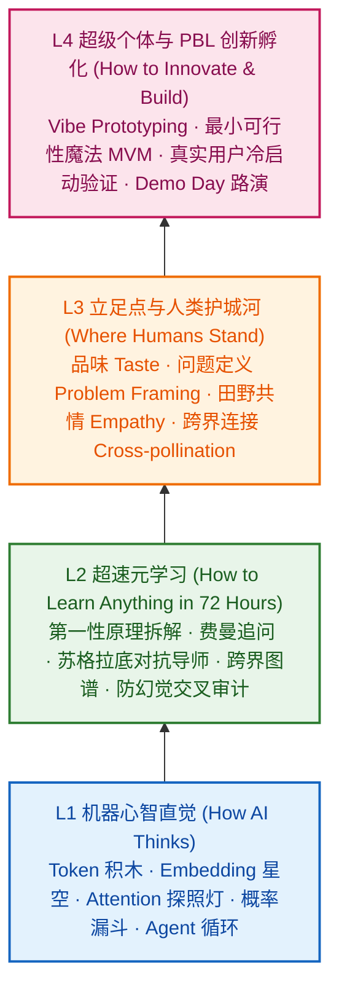
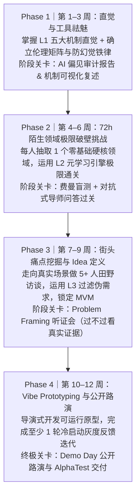

# 后大学时代青少年 AI 创新教育课程顶层设计方案

> **定位**：面向 12–18 岁青少年（初中段 & 高中段）的 AI 原生代创新力与元学习操作系统  
> **核心主张**：当知识获取的边际成本趋近于零，教育的重心必须从“记忆与复现答案”全面迁徙至“72 小时跨界破壁、AI 机制直觉、问题定义品味与真实世界交付”。

---

## 目录

- [一、时代背景与核心假设：为什么“大学可能消失”](#一时代背景与核心假设为什么大学可能消失)
- [二、全球前沿教育对标调研与本土化策略](#二全球前沿教育对标调研与本土化策略)
- [三、“四维金字塔”能力模型与课程结构](#三四维金字塔能力模型与课程结构)
- [四、学制安排、授课表现形式、PBL 运作机制与评估体系](#四学制安排授课表现形式pbl-运作机制与评估体系)
- [五、实施保障：导师角色重构与防异化护栏](#五实施保障导师角色重构与防异化护栏)

---

## 一、时代背景与核心假设：为什么“大学可能消失”

### 1.1 知识商品化与传统大学三重契约的失效

过去数百年，现代大学依托校园、图书馆与教授体系，维系着人类社会最高效的垄断契约。而在强人工智能（AGI/Frontier AI）迅速渗透工作流与学习场景的当下，大学赖以生存的三大支柱正在发生结构性崩塌：

1. **知识传递垄断的瓦解（边际成本归零）**  
   传统大学“4 年静态知识灌输”建立在信息稀缺与专家稀缺的前提之上。如今，生成式 AI 与多模态推理模型已能将高阶学科知识实时拆解、重构，并以符合学习者当前认知水准（最近发展区）的方式进行 1 对 1 交互教学。教育心理学中著名的 **Bloom 2-Sigma 难题**（1984 年 Benjamin Bloom 提出：一对一掌握学习可使普通学生超越传统大班教学 98% 的同龄人，此前因师资成本高昂而无法普及），正在被 AI 自适应导师在经济性上彻底破解。
2. **标准化考核与“文凭信号”的失灵**  
   经济学家 Schultz、Becker 的人力资本理论与 Spence 的文凭信号理论（Signaling Theory）正遭遇前所未有的挑战。一方面，传统的论文撰写、编程作业、闭卷标准测试已极易被生成式 AI 满分通过，引发全球性的**真实性评估危机（Authentic Assessment Crisis）**；另一方面，Google、Apple、IBM、Palantir 等头部科技企业已陆续削弱或取消部分岗位的本科学历硬门槛，转向基于**真实作品集（Proof-of-Work）与技能实测**的录用机制。
3. **“认知外包（Cognitive Outsourcing）”引发的技能侵蚀悖论**  
   如果青少年仅仅将 AI 当作“代写作业的工具”，虽然产出表面光鲜，却会导致自身的深度思考、概念综合与原创推理能力急速退化（Skills Erosion）。传统校内体系往往因为师资转型滞后与课程刚性，在“全面封禁 AI”与“放任代写”之间进退失据，无法教会学生如何在 AI 算力过剩的时代保留人类高阶心智的主权。

> **核心判断**：“消失”的并非大学作为物理社交场与前沿科研共同体的存在本身，而是**“以 4 年静态知识记忆 + 标准化试卷 + 纸面文凭背书”为核心商业模式的流水线高等教育形态**。青少年如果等到大学再开始转向创造与跨界学习，将失去整整六年的黄金窗口期。

---

### 1.2 青少年教育的三大范式转移

面对“大学文凭贬值、知识随取随用、工具半衰期缩短至数月”的新常态，面向 12–18 岁青少年的教育必须完成三次根本性的范式跃迁：

| 维度 | 工业时代传统教育范式 | 后大学时代 AI 原生创新范式 | 本质跃迁 |
| :--- | :--- | :--- | :--- |
| **学习方式** | **学知识（Know-What）** 按分科教材线性背诵，追求知识存量与做题熟练度 | **72 小时超速领域破壁（Meta-Learning & Rapid Domain Mastery）** 掌握拆解任何陌生学科的元认知方法论，72 小时内从零进入实战对话水平 | 从“静态存储”转向“动态调用与按需破壁” |
| **技术素养** | **纯代码技工（Pure Coding）** 死记硬背编程语言语法、API 细节与固定算法模板 | **AI 机制直觉 + 架构/导演思维（AI Intuition & Orchestration）** 凭视觉与机械直觉理解模型如何思考与出错，像导演一样编排多 Agent 完成系统构建 | 从“手工业执行者”转向“系统架构与意图导演” |
| **个人价值** | **标准答案做题家** 在封闭边界内争夺唯一正确解，回避不确定性 | **发现真痛点、建立生态位的超级个体（Problem Framing, Taste & Agency）** 走进真实生活发现被忽视的需求，以审美品味与行动力驱动创新 Idea 落地 | 从“被动解题”转向“主动定义问题与创造价值” |

---

## 二、全球前沿教育对标调研与本土化策略

为确保本课程体系具备国际顶尖的认知科学与工程教育水准，我们对全球五大最具代表性的前沿 AI 与创新教育项目进行了系统对标调研，并提炼其可迁移的方法论内核。

### 2.1 全球五大标杆项目深度解析

#### 1. MIT Media Lab：DAILy Curriculum（Developing AI Literacy）
* **机构与定位**：由 MIT Media Lab（STEP Lab / MIT RAISE）联合波士顿学院研发的开源 AI 素养课程，主要面向**初中段（5–8 年级，10–14 岁）**，包含 22 个模块化课程（约 32 学时）。
* **核心内容**：涵盖 AI 导论、监督学习与分类器训练、创造性 AI（如 GAN 生成对抗网络入门）、AI 与社会伦理。
* **核心启发**：
  * **“算法即观点（Algorithms as Opinions）”**：打破青少年对技术中立与权威的盲从，通过故意用有偏数据集训练分类器，让学生亲眼见证偏见如何从数据注入算法。
  * **伦理矩阵（Ethical Matrix）**：要求学生在设计任何 AI 系统前，先绘制直接与间接利益相关方（Stakeholders）的损益矩阵。
  * **不插电游戏与低门槛工具混排**：例如用团队角色扮演模拟 GAN 中的“生成器（造假者）”与“判别器（侦探）”对抗，再用可视化工具上机验证。

#### 2. Stanford CRAFT（Classroom-Ready Resources About AI for Teaching）
* **机构与定位**：由斯坦福大学教育学院（GSE）、以人为本人工智能研究院（HAI）及数字教育中心等联合打造，主要面向**高中段（9–12 年级）**，免费开源并由一线教师共同设计。
* **核心内容**：拒绝讲授生命周期极短的商业软件操作，聚焦“耐久的 AI 素养（Durable AI Literacy）”，模块跨学科嵌入科学、社会学、艺术与英文写作（如算法审计、AI 洪水预测、AI 版权与音乐伦理、面部识别与统计学）。
* **核心启发**：
  * **五步算法审计法（5-Step Algorithm Auditing）**：在 TikTok 滤镜偏见或图像搜索偏见实验课中，引导学生像调查记者一样“提出假设 → 采集样本数据 → 统计偏差 → 归因分析 → 提出改进建议”。
  * **跨学科寄生与融合**：证明 AI 教育不应被锁死在信息技术机房，完全可以成为探究社会公平、科学预测边界与艺术原创性的核心透镜。

#### 3. AI4K12 五大核心概念（Five Big Ideas in AI）
* **机构与定位**：由美国人工智能促进会（AAAI）与计算机科学教师协会（CSTA）联合制定，是全球 K–12 人工智能课程标准的权威坐标系。
* **五大核心支柱与分阶图谱（Grade Band Progressions：K–2 / 3–5 / 6–8 / 9–12）**：
  1. **感知（Perception）**：计算机通过传感器（摄像头、麦克风、激光雷达）提取信号并转化为语义特征。
  2. **表征与推理（Representation & Reasoning）**：智能体在内部构建世界模型（图、树、状态空间）并据此进行逻辑推理与规划。
  3. **学习（Learning）**：机器从海量数据中归纳统计模式，而非依赖人类穷举硬编码规则。
  4. **自然交互（Natural Interaction）**：理解人类语言、语境、情绪与社会文化常识的复杂性。
  5. **社会影响（Societal Impact）**：技术对隐私、就业、公平性与信息真实性的双重冲击。
* **核心启发**：为初高中两阶段提供了清晰的知识边界与认知螺旋上升支架，防止“对初中生讲高深矩阵微积分，或对高中生只做浅层工具体验”的双重错位。

#### 4. Minerva Project：思维习惯与跨学科远迁移引擎
* **机构与定位**：以重构高等教育闻名的创新教育体系（涵盖 Minerva University 与 Minerva Baccalaureate 高中项目），专门攻克认知科学中最难的**“远迁移（Far Transfer）”**问题——即如何将在 A 学科习得的思维模型自觉应用到完全陌生的 B 领域。
* **核心机制**：
  * **约 100–115 个颗粒化认知标签（HCs）**：拆分为**思维习惯（Habits of Mind, H）**（如辨别前提与结论、评估信源质量）与**基础概念（Foundational Concepts, C）**（如区分相关与因果、回归均值、机会成本、反馈回路），并赋予可追踪标签（如 `#rightproblem`、`#correlation`）。
  * **四大基石支柱（Cornerstone Pillars）**：形式分析（批判性思维）、实证分析（创造性思维）、多模态沟通（有效表达）、复杂系统（有效协作）。
  * **显性去语境化 + 跨情境间隔迁移**：先剥离学科外壳抽象讲解思维工具，再在后续数月里故意跨学科反复调用与评分，把零散知识锻造为统一的“认知操作系统”。

#### 5. Alpha School & Synthesis：AI 效率革命与高阶能力孵化
* **Alpha School（“2 小时学习法”模型）**：
  * **机制**：依托名为 TimeBack 的自适应 AI 软件，学生在上午用约 **2 小时**高密度完成数学、阅读、科学等标准化核心学业（严格执行掌握学习 Mastery Learning，未掌握绝不推进）。据其公开报告，该校学生整体在 NWEA MAP 标准化成长测试中位列全美前 1%–2%，学业平均增速达常规期望的 2 倍（严格跟进节律者可达 3.5 倍；注：部分独立媒体调研也指出并非所有学生均能长期维持 2 倍速天花板，个体自主驱动力仍是关键变量）。
  * **核心启发**：压缩传统课堂低效坐班时间后，下午近 4 小时全部用于 **Life Skills Workshops**（创业路演、演讲、耐力挑战、团队破壁）。教师转型为激励与数据追踪的 **Guide（引导师）**，并通过严苛的公开实战认证 **AlphaTest** 考核真实能力，彻底摒弃“参与奖”文化。
* **Synthesis（源自 SpaceX Ad Astra 实验校）**：
  * **机制**：由 Elon Musk 与 Josh Dahn 在 SpaceX 内部实验室学校 Ad Astra 的核心课程孵化而出，分为聚焦复杂博弈协作的 **Synthesis Teams** 与视觉化引导思考的 **Synthesis Tutor**。
  * **核心启发**：在信息不完备、时间受限、规则动态变化的沙盒模拟中，锻炼青少年权衡取舍（Trade-off）、复杂系统决策与团队领导力，完全绕开“有唯一正确答案”的应试陷阱。

---

### 2.2 对标对比总表与本土化改造策略

| 项目 | 核心年龄段 | 教学内核与方法论 | 最值得移植的亮点 | 潜在局限 / 需避坑点 |
| :--- | :--- | :--- | :--- | :--- |
| **MIT DAILy** | 初中 (10–14 岁) | 技术机制 + 伦理批判双轨并进 | “算法即观点”、伦理矩阵、GAN 不插电游戏 | 偏重认知启蒙，缺少持续数周的商业/产品级孵化闭环 |
| **Stanford CRAFT** | 高中 (14–18 岁) | 跨学科人文/科学融合与算法审计 | 五步算法审计流程、耐久概念框架 | 面向公立校随堂嵌入式设计，系统性建构深度有限 |
| **AI4K12** | K–12 全学段 | 五大核心概念 + 分龄能力阶梯 | 概念地图极其完整，确保科学严谨性 | 偏学科知识标准，未覆盖“元学习方法论”与“超级个体创业力” |
| **Minerva Project** | 高中 / 大学 | ~100+ HCs 显性迁移操作系统 | 去语境化思维工具标签（`#rightproblem` 等）、跨学科远迁移 | 训练强度极大，缺乏针对底层 AI 架构与快速原型的直觉模块 |
| **Alpha & Synthesis** | K–12 | AI 2h 刷题提效 + 下午真项目 / 博弈模拟 | Guide 角色转型、AlphaTest 实战通关、复杂决策沙盒 | Alpha 高学费与纯软件刷题易产生高压疲惫；中国语境下需兼顾校内升学节奏 |

#### 面向中国/华语青少年的三大本土化改造策略

1. **“课内提效 + 周末/假期破壁”的双轨兼容策略（适配应试现状）**  
   绝大多数华语青少年无法立刻脱离现行中高考或国际课程体系。因此本课程不要求学生“退学全脱产”，而是移植 Alpha School 的效率哲学——教学生用 AI 错题诊断与元学习法压缩传统死记硬背的耗时长尾，将挤出的时间集中投入每周 90 分钟核心课及 12 周学期制孵化营，实现“学术基线稳固”与“后大学能力跃迁”的良性共赢。
2. **用“视觉机械隐喻”破除文理分科恐惧与纯码农惯性**  
   国内青少年常走入两个极端：要么畏惧数学公式与英文代码不敢碰技术，要么陷入“背 Python 语法、刷竞赛套题”的纯技工内卷。本土化设计必须把 **L1 机器心智直觉** 做成零代码障碍的艺术流与物理沙盒体验，让艺术生、文科生与理科生站在同一起跑线上理解 AI 机制。
3. **重塑“提问权”与“街头勇气”（破除标准答案心理）**  
   受多年标准答案训练影响，华语青少年普遍存在“怕犯错、不敢当众挑战权威、不习惯与陌生人访谈”的隐性障碍。课程必须在 **L2（对抗式苏格拉底追问）** 与 **L3（街头田野调查）** 中设立强制性的安全试错场，并用 **AlphaTest 式的公开路演交锋** 代替温和的鼓励式评分，训练出在不确定性中保持锋利判断力的“超级个体”。

---

## 三、“四维金字塔”能力模型与课程结构

为了将上述全球洞见凝练为可执行、可度量的课程内核，我们构建了自下而上支撑、螺旋式互锁的 **“四维金字塔”能力模型（The 4-Layer AI Native Pyramid）**：

---

### L1：机器心智直觉（How AI Thinks）——底座

> **设计原则**：不教枯燥的微积分推导与手工写矩阵代码，而是对照 AI4K12 五大概念，通过**强视觉隐喻 + 物理机械沙盒**，让青少年在脑海里建立“AI 究竟是如何运转、又为何会一本正经胡说八道”的直觉心智模型。

| 核心概念 | 具象化视觉/物理隐喻 | 认知目标与防踩坑直觉 | 关联模块示例 |
| :--- | :--- | :--- | :--- |
| **Tokenization（切片）** | **文字切块积木机** | 理解 AI 看到的不是“汉字或单词”，而是按频率切分的数字碎片；看懂为什么 AI 过去常算不准“strawberry 里有几个 r” | 彩色积木切片演示（Motion Canvas） |
| **Embedding（高维嵌入）** | **高维语义星空罗盘** | 理解“意思相近的词在宇宙空间里距离更近”，感受矢量方向（如 `国王 - 男人 + 女人 ≈ 皇后`）的空间对称美 | 3D 语义星云手绘漫游（Three.js） |
| **Self-Attention（自注意力）** | **舞台探照灯与咬合齿轮组** | 理解词与词之间的动态上下文关联（如代词“它”的探照灯照向“小狗”还是“骨头”），而非孤立读字 | 注意力连线粗细实时调控（Motion Canvas） |
| **Next-Token Prediction（概率生成）** | **多分支概率落球漏斗 / 轮盘赌** | 彻底打破“AI 具有人类意识在思考”的幻觉：生成本质是接龙赌概率；亲手拨动 **Temperature / Top-P** 滑块理解严谨与创意的权衡 | 弹珠机械台与概率漏斗沙盒（Rapier/Matter.js） |
| **Agent Loop（智能体循环）** | **感知—大脑—手脚—照镜子闭环** | 区分“单次问答的聊天机器人”与“能调用工具、读取报错、自我修正的 Agent 工作流”，建立指挥多 Agent 协同的编排视野 | 机器人闯关/故障自愈沙盒 |

---

### L2：超速元学习（How to Learn Anything in 72 Hours）——引擎

> **设计原则**：借鉴 Minerva HCs 思维习惯与超速学习理论，训练青少年将 AI 转化为“私人认知外骨骼”。目标是在面对完全陌生的领域（如分子料理、量子计算科普、本地社区垃圾分类法规、独立游戏着色器）时，能在 **72 小时内建立起专业级的概念地图并展开有深度的创造**。

1. **第一性原理概念树拆解（First-Principles Concept Tree）**  
   * **操作法**：要求学生先禁止直接问 AI“给我总结某某领域”，而是用结构化 Prompt 逼迫 AI 抽取该领域“最底层的 5–8 个不可再分公理/核心矛盾”，画出概念依赖树（Dependency Tree），识别“学懂哪 20% 的核心节点就能撬动 80% 的场景”。
2. **费曼盲区追问法（Feynman Interrogation）**  
   * **操作法**：学生用自己的大白话（或画一张草图）向 AI 复述刚刚理解的概念，并设定系统指令让 AI 扮演“完全不懂行的 10 岁小学生”或“挑剔的领域专家”，专找逻辑跳跃与术语遮羞布，直到能零术语讲透因果。
3. **苏格拉底对抗式 AI 导师（Socratic Red-Teaming Tutor）**  
   * **操作法**：严禁 AI 直接吐出完整结论。通过预设“红蓝对抗协议”，AI 必须不断抛出反例、极端边界条件与两难追问（借鉴 Synthesis 的决策压力测试），倒逼学生亲自做出推演并承担论证责任。
4. **Minerva 式跨学科知识图谱与远迁移标签**  
   * **操作法**：为学到的概念打上跨界元标签（例如把生物学“生态位竞争”与商业“差异化定位”锚定到同一个 `#feedback-loop` 节点），训练“看到新现象立刻匹配异域模型”的联想肌肉。
5. **防幻觉交叉审计协议（Anti-Hallucination & Triangulation Protocol）**  
   * **操作法**：结合 Stanford CRAFT 审计法与新闻核查逻辑，强制推行**“三源交叉验证铁律”**：凡是核心数据、历史事实与代码结论，必须经过“跨模型对质 + 一手文献/官方数据源溯源 + 逻辑一致性反推”三道关卡，绝不轻信单一生成结果。

---

### L3：立足点与人类护城河（Where Humans Stand）——脊梁

> **设计原则**：当执行力（写文章、写代码、画图、做表格）越来越便宜时，人类唯一的不可替代性在于**“判断什么值得被创造、谁在为此痛苦、以及作品的灵魂在哪里”**。这是后大学时代真正区分平庸操作员与“超级个体”的分水岭。

1. **品味与审美判断（Taste & Curation）**  
   * 面对 AI 瞬间生成的 50 个平庸方案，学生必须训练出“一秒看出第 17 号方案为什么有灵气、其余 49 个为什么俗套”的鉴赏力。课程通过高频对比经典设计、开源美学作品（如手绘着色器艺术）、反套路叙事，建立“好坏坐标系”与审美主权。
2. **问题定义力（Problem Framing）**  
   * 借用 Minerva `#rightproblem` 核心思维习惯：90% 的失败项目死于“用极高效率解决了一个没人真正在乎的假问题”。学生要学会剥离表象抱怨（“我想要一个背单词 App”），追问深层卡点（“为什么我在地铁上打开软件 30 秒就想刷短视频？”），将模糊不适转化为精确可解的命题。
3. **街头田野调查与深度共情（Field Research & Empathy）**  
   * 强制离开屏幕与教室：带着录音笔、观察笔记走进菜市场、学校食堂、医院候诊区、老年活动中心或二次元漫展，执行“5 次追问为什么（5 Whys）”与“行为观察而非只听嘴说（Say vs. Do）”。AI 永远无法代替人类在真实物理现场捕捉到的微表情与叹息。
4. **跨界连接力（Cross-pollination）**  
   * 鼓励“非理性混搭”：把《红楼梦》的人物关系图谱方法论用于分析社区邻里矛盾调解，或把游戏化肉鸽（Roguelike）机制嫁接到初中物理错题闯关中。创新极少源于单一垂直领域的深挖，而多生发于两条陌生认知河流的交汇三角洲。

---

### L4：超级个体与 PBL 创新孵化（How to Innovate & Build）——顶冠

> **设计原则**：融合 Andrej Karpathy 提出的 **Vibe Prototyping / Agentic Engineering** 理念与敏捷精益验证思想，让青少年学会以“一个人就是一支产品研发队伍”的导演姿态，把 L3 定义的真痛点变成现实世界触手可及的解决方案。

1. **Vibe Prototyping（意念原型化与 Agent 编排）**  
   * 学生不再是逐行敲打括号的分号工，而是担任“总导演 + 产品架构师”：清晰撰写意图规格说明（Intent Spec）、拆解模块边界、调度编码/绘图/语音多模态 AI 工具流，在数小时内拉起可交互的 Web 应用、物理互动装置或媒体叙事作品，并学会阅读报错与指导 AI 修复而非盲目全盘重写。
2. **最小可行性魔法（MVM — Minimum Viable Magic）**  
   * 传统工程讲 MVP（最小可行产品，常简陋到没人想用）；在 AI 时代，基础功能极易复制，青少年作品必须追求 **MVM**：砍掉 90% 的冗余功能，只集中全力打磨**那 1 个让真实用户眼前一亮、情绪被击中或效率瞬间翻倍的“魔法时刻”**。
3. **真实用户冷启动与灰度验证**  
   * 作品严禁停留在“老师和家长夸好”的温室里。学生必须设计最小验证实验（如假门测试、街头扫码试用、真实社群投放），回收冷冰冰的留存率、使用卡点与吐槽原话，完成至少一轮基于真实反馈的痛点重构。
4. **Demo Day 公开路演与 AlphaTest 级交付**  
   * 每学期收官对标 Alpha School 的 **AlphaTest** 精神与创业路演标准：在外部真实用户、行业极客、跨界评委面前，用 5 分钟现场演示可运行的原型，并接受 5 分钟“不留情面的犀利质询（Roast & Defend）”。

---

## 四、学制安排、授课表现形式、PBL 运作机制与评估体系

### 4.1 初中段 vs. 高中段分龄学制与进阶梯度

青少年在 12–18 岁间认知成熟度跨度巨大，必须严格区分 **初中启蒙期** 与 **高中孵化期** 的培养目标与学时模型：

| 对比维度 | 初中段（12–15 岁）：启蒙与心智模型期 | 高中段（15–18 岁）：破壁与独立孵化期 |
| :--- | :--- | :--- |
| **核心认知特征** | 具象形象思维向抽象逻辑过渡；好奇心旺盛，但耐挫力与长程项目规划能力较弱；易对 AI 产生“拟人化迷信” | 抽象逻辑与元认知成熟；自我认同与社会观察意识觉醒；具备独立抗压、多任务协调与跨学科理论抽象能力 |
| **四维模型权重分配** | **L1 (35%) · L2 (30%) · L3 (20%) · L4 (15%)** 重在建立精准机器直觉、祛魅 AI 与玩转探索方法 | **L1 (15%) · L2 (25%) · L3 (30%) · L4 (30%)** 重在深度田野问题定义、复杂原型编排与真实市场交付 |
| **AI 工具与编排深度** | 可视化沙盒、无代码/低代码流、结构化 Prompt 模板、基础单轮/双轮 Agent 编排 | 多 Agent 协同架构（Agentic Engineering）、阅读与审查生成代码逻辑、独立配置 API/知识库与审计指标 |
| **学时与双轨制安排** | **日常学期制**：12 周/学期，每周 1 次线下/同步课（90 分钟）+ 每周 60 分钟自由沙盒任务 **寒暑假加强营**：5 天 × 6 小时沉浸式主题破壁营 | **日常学期制**：12 周/学期，每周 1 次核心课（90 分钟）+ 每周 2–3 小时自主田野/原型 Sprint **寒暑假加强营**：7 天黑客松与真实用户交付冲刺营 |
| **阶段性核心产出** | 1 个可视化 AI 机制故事/交互小游戏 + 1 份跨学科 72h 破壁笔记 + 1 次微型校园痛点原型 | 1 份算法/幻觉独立审计报告 + 2 次 72h 陌生领域极限破壁档案 + 1 个经过真实用户付费/使用验证的 MVM 作品与 Demo Day 路演 |

---

### 4.2 单次课 90 分钟黄金结构（The 90-Minute Golden Loop）

摒弃“45 分钟教师单向 PPT 讲授 + 45 分钟机械上机模仿”的传统模式，每一节核心课均严格遵循高密度、强交互的 **15-25-35-15** 黄金节律：

```mermaid
gantt
    title 单次课 90 分钟黄金结构节奏图
    dateFormat mm
    axisFormat %M min
    section 课程节奏
    1. 视觉/动画直觉引入 (Metaphor Hook)    :a1, 00, 15m
    2. 交互沙盒实验 (Interactive Sandbox)     :a2, 15, 25m
    3. PBL 破壁实战 (Sprint)                  :a3, 40, 35m
    4. 思辨与路演交锋 (Critique & Pitch)      :a4, 75, 15m
```

| 时间窗 | 环节名称 | 导师（Guide）核心动作 | 学生（Builder）核心体验 | 配套教学载体 |
| :--- | :--- | :--- | :--- | :--- |
| **00–15 min** (15 分钟) | **视觉/动画直觉引入** *(Metaphor Hook)* | 不下干瘪定义，用反常识现象或极美视觉隐喻引爆悬念（例：“为什么 AI 把‘林黛玉倒拔垂杨柳’画得毫无违和感，却数不清字母个数？”） | 产生强烈“认知好奇与直觉冲突”，形成本节课要攻克的 1 个核心思维谜题 | **Three.js 手绘艺术流开场** / **Motion Canvas 高精机制微动画** |
| **15–40 min** (25 分钟) | **交互沙盒实验** *(Interactive Sandbox)* | 抛出 2–3 个控制变量实验任务，巡场记录异常现象，不做保姆式排错 | 亲手拖拽沙盒滑块（如调高 `Temperature` 看词球乱跳、往训练集故意投毒看分类崩坏），自主归纳规律 | **物理机械沙盒** / **Slidev 嵌入式实时参数面板** |
| **40–75 min** (35 分钟) | **PBL 破壁实战** *(Sprint)* | 扮演“苏格拉底追问者”与“资源哨兵”，当学生直接找 AI 要答案时，反问：“你的问题定义在哪？交叉验证做了吗？” | 按 2–3 人小组或超级个体模式，将刚悟出的机制或元学习工具立刻应用到自己选定的真实课题冲刺中 | **AI 对话审计日志** + **Vibe Prototyping 工作台** + **白板便签** |
| **75–90 min** (15 分钟) | **思辨与路演交锋** *(Critique & Pitch)* | 主持快节奏“亮剑交锋”（每人/每组 90 秒展示 + 90 秒质询），锚定当堂核心 Minerva 思维标签（如 `#correlation`） | 上台展示半成品原型或反例发现，互相挑刺（找出逻辑漏洞、伪痛点或幻觉硬伤），完成当堂认知固化 | **Slidev 倒计时路演板** + **现场互评雷达卡** |

---

### 4.3 学期制 12 周 PBL 孵化漏斗（12-Week Incubation Funnel）

每学期 12 周采用严格的**“发散—破壁—聚焦—验证—交付”漏斗架构**，确保学生从好奇心进入，最终手里拿着真实的、经过社会摩擦的作品走出教室：

* **第 1–3 周：直觉唤醒与工具祛魅（Intuition & Tooling）**  
  * 破除对 AI 的神化与畏惧，用沙盒玩透 Token、Embedding、Attention、概率采样与幻觉来源；建立“三源交叉验证”基本动作与 MIT 伦理矩阵意识；完成首次微型跨模态创作与算法审计演练。
* **第 4–6 周：72 小时陌生领域极限破壁挑战（72h Rapid Mastery Sprint）**  
  * 模拟“未来大学消失后，遇到新工作/新危机必须在 3 天内成为半个专家”的极限情景。例如：周四晚公布随机跨界课题（如*“用声学原理分析地铁噪音并设计校园静音区方案”*或*“72 小时读懂宋代交子崩溃机制并设计防通胀桌游”*），周日晚提交概念依赖树、红队对抗问答记录与向低年级同学做的 3 分钟费曼科普微演示。
* **第 7–9 周：街头痛点挖掘与创新 Idea 定义（Field Research & Problem Framing）**  
  * 彻底关掉电脑走进社区、校园角落、家庭真实场景或兴趣社群，带着观察清单搜集“真痛点”。设立严苛的 **第 9 周“杀掉伪需求”听证会**：拿不出真实访谈录音/观察笔记、或者问题可用一张备忘录纸解决的方案，当场砍掉重定，杜绝“为了用 AI 而硬造需求”。
* **第 10–12 周：Vibe Prototyping、冷启动验证与 Demo Day（Build, Validate & Pitch）**  
  * 第 10 周完成极简 Intent Spec 与首版可交互原型（MVM）；第 11 周必须将产品推给至少 5–10 位非亲友真实目标用户使用，收集真实卡点并迭代 v2；第 12 周举办面向家长、行业导师、社区代表与媒体/开源社群的 **Demo Day**，所有作品以可访问链接或现场交互装置形态永久沉淀进个人数字档案袋。

---

### 4.4 多样化授课表现形式矩阵（制作与组合时机）

承接本团队已确立的视觉化与交互式技术栈（参见《面向初高中生 AI 科普的动画技术栈与教学方案调研报告》及 `demos/` 工程结构），我们将授课载体划分为**五大核心形式**，拒绝“全盘 PPT”或“炫技式纯动画”，严格按认知负荷与教学阶段精确编排组合：

#### 1. 研发生产铁律：**剧本先行（Script-First）**
任何技术动画在敲下第一行渲染代码前，必须先产出一份**经过初中生/高中生预读盲测的纯文字剧本与分镜表**。文字负责锁定逻辑严密性、认知跳跃步长与情感钩子；技术只是服务于剧本核心隐喻的放大器。

#### 2. 五大表现形式组合时机矩阵

| 表现形式 | 技术对应/工程基础 | 最佳触发时机 | 解决的独特教学痛点 | 制作与使用边界（忌讳） |
| :--- | :--- | :--- | :--- | :--- |
| **① 文字剧本与分镜** | Markdown 教学分镜稿 | **课前研发第 0 步** / **课中苏格拉底思辨卡片** | 剥离华丽特效，暴露“概念跳步”或“伪逻辑”；是后续生成 Slidev 与动画代码的单一事实来源（Single Source of Truth） | 忌直接以大段纯文本投影给学生看 |
| **② Slidev 互动讲义** | `demo2-motion-slides` (Vue 3 + Markdown) | **全堂课 90 分钟主骨架串联** | 极低制作成本串联课程脉络；无缝内嵌实时投票、可折叠 Prompt 范例与局部动画组件，方便教师即兴切入讨论 | 忌退化为满屏文字的传统 PPT；单页信息不超过 1 个核心锚点 |
| **③ Motion Canvas 程序化动画** | `demo2-motion-slides` 局部嵌入 (TypeScript + WebGL) | **L1 机制拆解难点**（第 5–20 分钟、10–30 秒微循环） | 精确控制时间轴与补间，把抽象的数据流动（Token 切割、Attention 权重线粗细渐变、矩阵一步步折叠）变得像齿轮一样精准清晰 | 忌做长达 3 分钟以上的单向长视频，超过 30 秒学生注意力即开始游离 |
| **④ Three.js + GLSL 手绘艺术流** | `demo1-kujira-art` (Three.js + Shaders + Web Audio) | **00–15 分钟开场 Hook** / **语义空间漫游** / **哲学升华时刻** | Kuwahara 手绘滤镜与纸张质感构建“AI 心智海洋”等极具审美震撼力的空间，瞬间破除青少年对技术的冰冷疏离感，滋养 L3 审美品味 | 开发门槛高，只用于每单元 1–2 个高光核心隐喻，切忌为了炫技而遮蔽机制因果 |
| **⑤ 物理机械沙盒** | `demo3-mechanical-sandbox` (Rapier / Matter.js + Canvas) | **15–40 分钟交互实验段** | 真正实现“动手破坏与试错”：拖拽 `Temperature` 滑块看弹珠漏斗分布变形、改变数据源偏置比例看分类器失衡，形成深刻肌肉记忆 | 忌预设好唯一参数让全班机械照搬；必须设计开放的“极端边界破坏挑战” |

#### 3. 典型一节课的媒体交响曲示范：《AI 是如何读懂一句话并瞎编出下一句的？》
1. **00–05m（Three.js 手绘艺术流）**：屏幕化作水彩手绘质感的高维星空（`demo1`），句中的词化作星光坠入语义星海，同类词磁吸聚拢，引出悬念：“词在机器眼里原来不是文字，而是星海里的坐标。”
2. **05–15m（Slidev + Motion Canvas 微动画）**：切入 `demo2`，用 20 秒精准循环动画演示“句子被切成彩色 Token 积木”以及“代词‘它’的探照灯如何照向‘骨头’而非‘小狗’”。
3. **15–40m（物理机械沙盒）**：打开 `demo3` 弹珠机械台，学生亲自把 `Temperature` 从 `0.1` 拉到 `1.8`，观察代表候选词的漏斗开口与弹珠随机弹跳幅度如何剧变，亲手制造出一次“高温度下的离谱幻觉”。
4. **40–90m（文字思维协议 + Vibe 工作台 + Slidev 计时器）**：学生分组实战，设计一个测试大语言模型注意力盲区的“反常识提示词陷阱集”，并上台 90 秒快闪攻防。

---

### 4.5 去应试化的 PBL 评价量规（Rubric）与数字档案体系

为了防止评估重新滑回“背概念、比谁界面华丽、看谁最像大人写的标准答案”，本课程建立基于**真实世界交付证据（Proof-of-Work）**的 **“4+1”去应试化评估体系**。

#### 1. “4+1”多维真实性评估量规（1–4 级行为锚定评分表）

| 评估维度 | 1 级：学徒 (Apprentice) | 2 级：探索者 (Explorer) | 3 级：破壁者 (Maverick) | 4 级：架构师 (Architect) |
| :--- | :--- | :--- | :--- | :--- |
| **D1. 机制迁移与追问深度** *(对应 L1 + L2)* | 能复述课程比喻，但对话记录显示只是单向向 AI 要答案 | 能说出故障的大致机制原因；会尝试用费曼追问让 AI 换种讲法 | 能主动针对盲区对 AI 进行多轮苏格拉底反诘，留下清晰的认知推演与纠偏轨迹 | 能跨学科调用 Minerva 思维标签（如因果错位、系统反馈），并用 1 个自创比喻向低龄者讲透复杂机制 |
| **D2. 问题真实性与田野证据** *(对应 L3)* | Idea 全凭脑补，未离开电脑调研，痛点模糊或为伪需求 | 采访了 1–2 位熟人（如父母/同学），但提问带有诱导性且停留在表面 | 走进真实场景观察并访谈 ≥3 位陌生/目标用户，保留原始录音或观察笔记，精准重定义真问题 | 从真实行为矛盾（说与做不一致）中挖出极小众却高价值的切口，甚至勇敢推翻并迭代了自己最初的假设 |
| **D3. 系统编排与 MVM 魔法度** *(对应 L4)* | 仅有静态 PPT 或概念图，或代码/内容完全由 AI 一键生成且自己说不清逻辑 | 做出了基础可运行原型，但功能堆砌平庸，缺乏明确的核心体验亮点 | 像导演一样精准拆解并编排多步 AI 工具链，砍掉冗余，打造出令人眼前一亮的 1 个“魔法时刻” | 原型稳定度与体验极佳，能清晰解释架构边界、AI 失误兜底策略及人机协同分工依据 |
| **D4. 防幻觉核查与伦理自觉** *(对应 L2 + CRAFT/MIT)* | 未核查输出内容，作品中存在明显 AI 虚构事实或盲目数据偏差 | 对关键事实做过 1 次表面搜索核对，知道可能有隐私问题但未处理 | 严格执行“三源交叉验证”标注，主动提交项目的《潜在偏见与利益相关方伦理矩阵》及规避方案 | 像侦探一样系统审计了模型或数据的隐性偏差，并在产品设计层面内嵌了防护护栏或透明度提示 |
| **+1. 真实世界回响** *(AlphaTest 实战通关项)* | 仅在课堂内部向导师和队友演示 | 获同班同学主动试用并提出有效修改意见 | 作品投放到真实目标场景，获得 **≥5 位非亲友真实用户** 的有效使用记录与真实批评反馈，并完成 1 轮公开迭代 | 产生真实外部影响（如被社区/学校实际采纳、开源获真实关注、产生真实用户自发传播或象征性微付费验证） |

#### 2. 成果沉淀：面向后大学时代的个人“能力数字档案袋（Proof-of-Work Portfolio）”

课程结业不发一纸空洞的“结课证书”，而是为每位青少年生成一套**可公开核验、随时间生长的个人能力主页与 Git/作品集仓库**，包含四大硬核资产：
1. **《72 小时破壁思维日志》**：记录他如何在 3 天内攻克一个完全陌生领域的概念树、红队交锋对话与费曼微视频（证明**超速学习力**）。
2. **《田野手记与算法审计单》**：原始访谈洞察、问题重构链条与对某主流 AI 系统的偏见审计报告（证明**问题定义力与批判力**）。
3. **《MVM 线上可交互原型》**：一个任何人点开链接就能直接试玩/使用的真实产品，而非只能看的截图（证明**超级个体交付力**）。
4. **《Demo Day 路演与质询录像》**：5 分钟演讲 + 5 分钟高压快问快答实录（证明**真实沟通与临场思辨抗压能力**）。

---

## 五、实施保障：导师角色重构与防异化护栏

再先进的课程架构，若仍用旧时代的“标准答案执行官”去讲授，也会迅速退化。体系落地必须伴随以下两项底层制度保障：

1. **导师角色的彻底重构：`Lecturer` → `Guide + Challenger`**  
   * 借鉴 Alpha School 的 **Guide（引导师）** 定位与 Minerva 课堂的 **批判性对话者** 角色，导师严禁在 15 分钟引入环节之外连续讲课超过 5 分钟。导师的核心 KPI 不是“讲完多少页讲义”，而是：**是否及时抓住了学生向 AI 懒惰索取答案的瞬间并用一个反问逼他自己思考；是否守住了第 9 周“杀掉伪需求”的田野门槛**。
2. **四大“防异化”安全护栏（Guardrails）**  
   * **反认知外包红线**：任何 PBL 成果必须附带“人机对话决策摘录与自我修改说明”，说不清自己作品为何这样设计、或无法现场口头解释核心逻辑的，一律视为未过关。
   * **反屏幕成瘾节奏控制**：严格控制连续盯屏时长，每节课强绑定物理白板推演、线下小组辩论、实物纸模或街头行走观察，确保青少年保持与物理世界及真实人类的血肉连接。
   * **允许“体面失败（Honorable Failure）”机制**：如果一个学生在真实用户测试中发现自己花了 3 周做的点子完全没人买单，只要他能带着真实数据复盘出“为什么行不通、用户到底想要什么”，在评估量规上依然可以获得最高级别评价——**后大学时代的教育奖励真实探索的勇气，而非温室里包装出来的虚假成功。**
